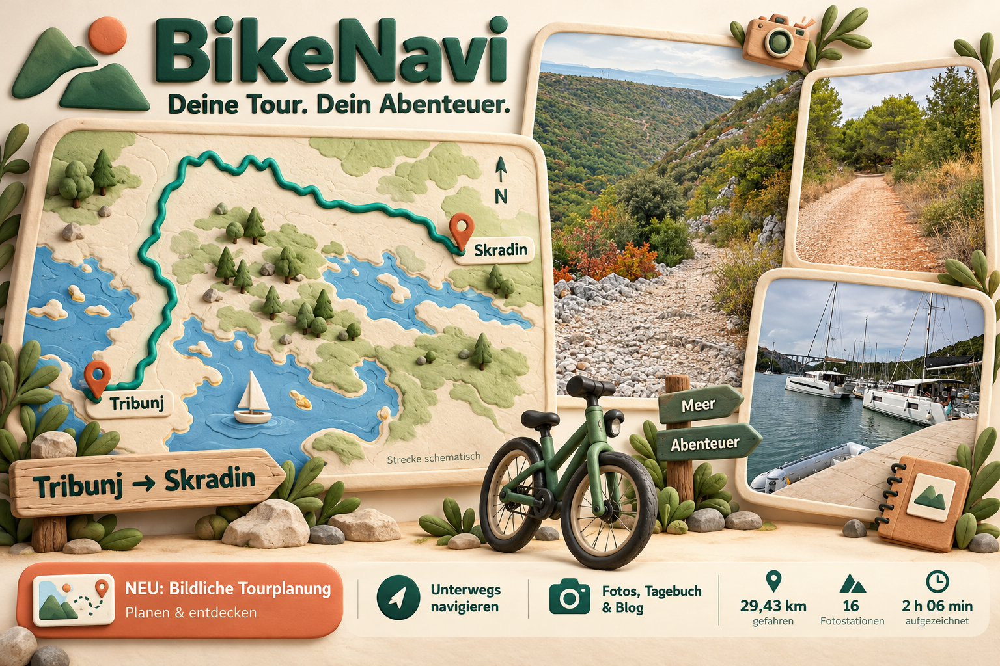
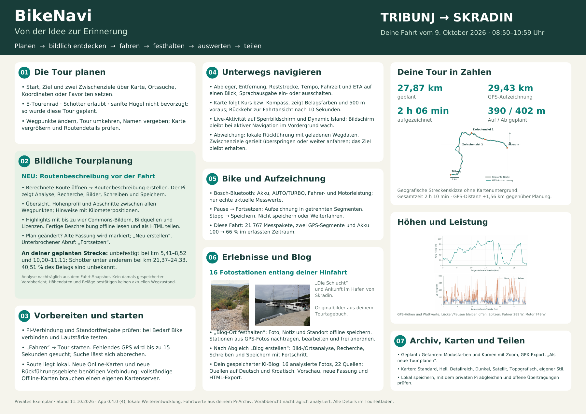
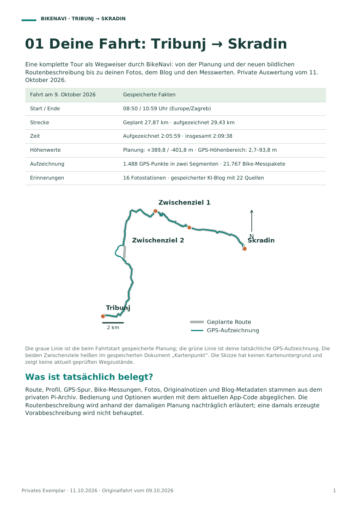
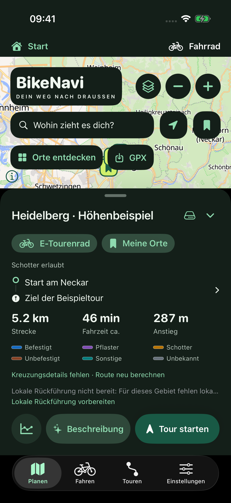
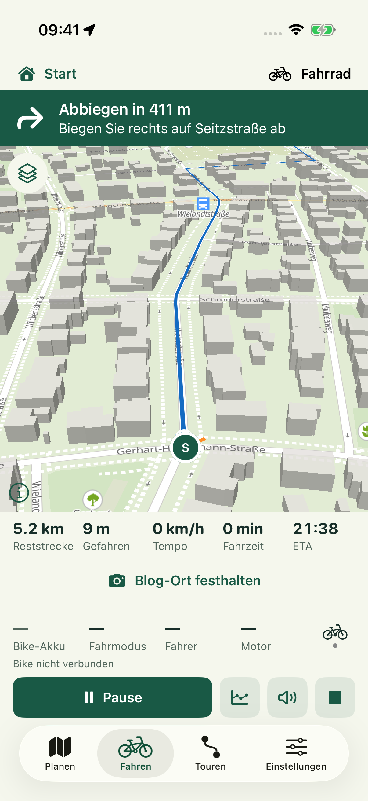
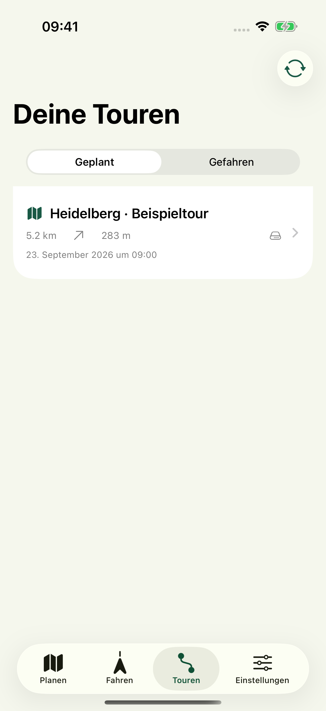
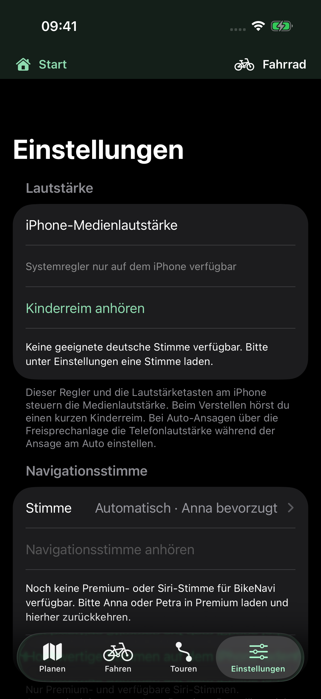
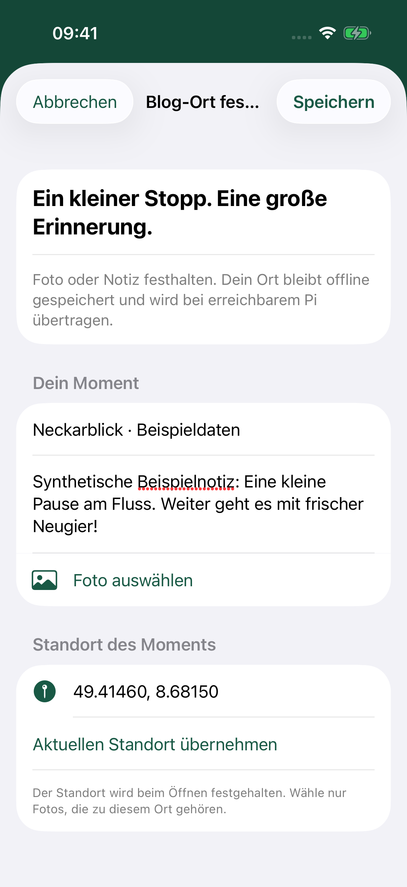
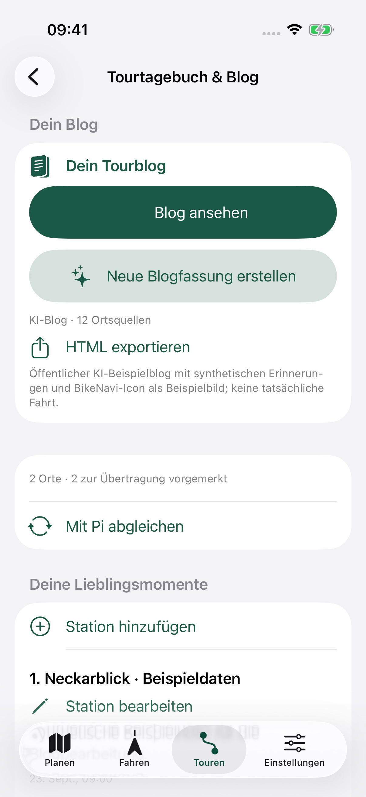
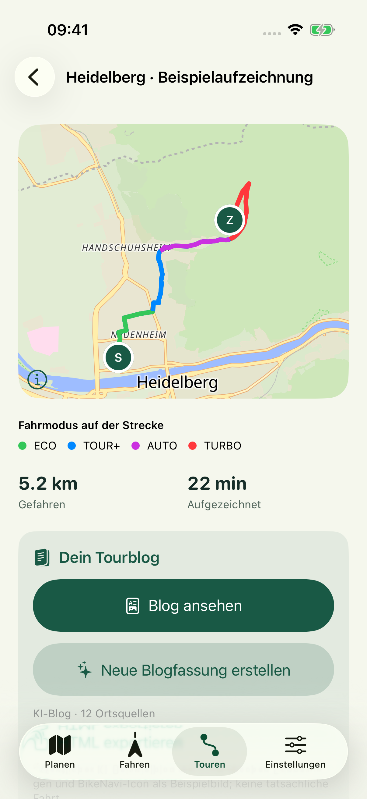

<p align="center"><a href="docs/praesentation/README.md"></a></p>

# BikeNavi

**Deine Tour. Dein Abenteuer.** Fahrradtouren auf dem iPhone planen, unterwegs navigieren und mit Fotos, Messwerten und einem Reiseblog in Erinnerung behalten.

**[BikeNavi entdecken →](docs/praesentation/README.md)** · **[Werbetafel als PDF](docs/praesentation/BikeNavi-Werbetafel-Clay-Tribunj-Skradin-A2.pdf)** · **[Alle Funktionen auf einer Schautafel](docs/praesentation/BikeNavi-Schautafel-Tribunj-Skradin-A2.pdf)** · **[Tourleitfaden lesen](docs/praesentation/BikeNavi-Tourleitfaden-Tribunj-Skradin-A4.pdf)**

**Vorabversion 0.5.0-rc.1 · App 0.5.0 · iOS-Build 5 · Fahrabnahme ausstehend**

[Release-Notizen](docs/releases/0.5.0-rc.1.md) · Stabile Version weiterhin [v0.4.0](https://github.com/MichaelHein65/BikeNavi/releases/tag/v0.4.0).

Serverkorrektur nach RC1: **Offline-Regionsdownloads für Kroatien über den Pi wieder funktionsfähig**, mit lokalem geprüftem OSM-Länderindex. Bestehende App 0.5.0 (5) bleibt kompatibel; Korrektur unter Unveröffentlicht. [Quellenstand, Abdeckung und Aktualisierung](docs/RAD_OFFLINE.md#lokale-osm-quelle-auf-dem-pi).

[Änderungen](CHANGELOG.md) · [GitHub-Releases](https://github.com/MichaelHein65/BikeNavi/releases) · [Alle Bildschirme](docs/BILDSCHIRME.md) · [Versionierung](docs/VERSIONIERUNG.md)

Native iPhone-App für Fahrradtouren mit einem privaten Raspberry-Pi-Backend. Produktentscheidungen stehen in [docs/KONZEPT.md](docs/KONZEPT.md), die technische Struktur in [docs/ARCHITEKTUR.md](docs/ARCHITEKTUR.md) und der tatsächliche Entwicklungsstand in [docs/UMSETZUNG.md](docs/UMSETZUNG.md).

Aktueller Entwicklungsstand vom **21. Oktober 2026**: GPX-Originalspuren, lokale Rad-Routenvarianten, begrenzte Offline-Regionen mit einfacher Wegenetzkarte, drei Fahransichten und Offline-Orte. Die bisherigen Auto-, Wander-, See-, Bosch- und Blogfunktionen bleiben erhalten. Automatisierte Tests und signierter Gerätebuild sind geprüft; reale Fahrabnahme steht aus. Der Energie-Datenaudit reicht nicht für eine numerische Akku-Prognose. [Rad-Bedienung und Grenzen](docs/RAD_OFFLINE.md) · [GPX](docs/GPX.md) · [Prüfung und Bereitstellung](docs/UMSETZUNG.md#vorabversion-050-rc1--21-oktober-2026).

## Von Tribunj nach Skradin: BikeNavi erleben

**29,43 km aufgezeichnete Strecke · 16 Fotostationen · 2 h 06 min aufgezeichnete Zeit.** Das vom Projektinhaber für die Veröffentlichung freigegebene Tourbeispiel vom 9. Oktober 2026 zeigt, wie Planung, Navigation, Bike-Daten, Tagebuch und Auswertung zusammenspielen.

| Lust auf die nächste Tour | Alle Funktionen im Überblick | Schritt für Schritt durch die App |
| --- | --- | --- |
| [](docs/praesentation/BikeNavi-Werbetafel-Clay-Tribunj-Skradin-A2.pdf) | [](docs/praesentation/BikeNavi-Schautafel-Tribunj-Skradin-A2.pdf) | [](docs/praesentation/BikeNavi-Tourleitfaden-Tribunj-Skradin-A4.pdf) |
| **[Clay-Werbetafel · A2-PDF](docs/praesentation/BikeNavi-Werbetafel-Clay-Tribunj-Skradin-A2.pdf)** | **[Schautafel · A2-PDF](docs/praesentation/BikeNavi-Schautafel-Tribunj-Skradin-A2.pdf)** | **[Tourleitfaden · 8 Seiten A4](docs/praesentation/BikeNavi-Tourleitfaden-Tribunj-Skradin-A4.pdf)** |

Die **bildliche Tourplanung** ist ein neuer Entwicklungsstand vom 11. Oktober 2026: Routenabschnitte, Beläge, Höhenhinweise und bebilderte Highlights vor der Fahrt entdecken. Die Dokumente erläutern diese Weiterentwicklung zusätzlich zur veröffentlichten App-Version 0.4.0. Die Clay-Tafel ist eine KI-gestaltete Werbeillustration auf Basis der Tourfotos; ihre Karte ist schematisch.

## Einblicke in die App

Echte Simulator-Aufnahmen mit öffentlicher Heidelberger Beispielroute. Die Beispielaufzeichnung und ihre Bike-Messwerte sind synthetische Demonstrationsdaten.

| Planen | Fahren | Touren | Einstellungen |
| --- | --- | --- | --- |
|  |  |  |  |

Die [vollständige Galerie](docs/BILDSCHIRME.md) zeigt außerdem Karte, Wegpunkte, Favoriten, Suche, Fahrprofil, Routendetails, [freie Fahrt ohne Strecke](docs/BILDSCHIRME.md#freie-fahrt-ohne-strecke), Fahrtaufzeichnung, Diagramme, Bike-Verbindung und Pause.

## Starten

1. `BikeNavi.xcodeproj` in Xcode öffnen und das Scheme **BikeNavi** wählen.
2. Für den Simulator ein iPhone mit iOS 17 oder neuer auswählen und starten.
3. Für ein echtes iPhone unter **Signing & Capabilities** das eigene Development Team wählen. Das iPhone muss Zugriff auf das private Tailscale-Netz haben.
4. In der App unter **Einstellungen** die eigene Tailscale-HTTPS-Adresse und den BikeNavi-Zugangsschlüssel aus der lokalen `.env` eintragen.
5. **Speichern und Verbindung prüfen** antippen. Danach Start und Ziel auf der Karte setzen oder über die Suche auswählen.

Die bisherige Fahrrad-Streckenplanung erfolgt mit eingerichtetem Pi über openrouteservice und benötigt einen ORS-Schlüssel auf dem Pi. Die neuen Rad-Routenvarianten nutzen den lokalen Graph; eine passende vollständig gespeicherte Region ermöglicht die Planung ohne Pi. Dabei wird kein Wegenetz entlang der gesamten Tour heruntergeladen. Die lokale Rückführung lädt unabhängig davon das Umfeld um den Standort und hält während der Fahrt einen Suchradius von drei Kilometern bereit, soweit die Daten rechtzeitig verfügbar sind. Ohne eingerichteten API-Client bleibt die lokale Planung aus vorhandenen Gebietsdaten möglich.

## Universeller Einstieg

Der bunte Startbildschirm zeigt alle fünf Kacheln mit kleinen Clay-Illustrationen gleichzeitig auf einer Seite, ohne Scrollen. Bilder, Abstände und Zusatztexte passen sich der verfügbaren Bildschirmhöhe an, auch mit „Fahrt fortsetzen“. Wähle zuerst deine Aktivität, danach setzt du wie gewohnt Start, Ziel und Zwischenziele. Eine Modusliste in den Planungseinstellungen entfällt.

- **Fahrrad:** Radtyp, elektrische Unterstützung, Belag und Steigungen; Bike-Messwerte während der Fahrt.
- **Auto:** Autobahn-/Maut-/Fährvermeidung, Pkw-Fahrzeit, eigene Fahransicht und Auto-Zoom.
- **Wandern:** einfache Wanderwege, topografische Grundkarte, nähere Kartenansicht und Gehzeit; keine Fahrradwerte.
- **Fahrrad & Wandern:** Radanfahrt, markierter Abstellpunkt und anschließender Fußweg. Im Fußabschnitt werden keine Fahrradwerte angezeigt oder neu erfasst.
- **Segeln:** Seekarte, Tiefgang und Bootstempo; Kurs, Wegpunktpeilung, kn/sm und maritime ETA. Die bestehenden Grenzen experimenteller Seewegplanung gelten weiterhin.

Mit **Start** oben links kehrst du zur Auswahl zurück. Jede Kachel öffnet ihren letzten eigenen Entwurf; **Neue Tour** und **Planung zurücksetzen** behalten Anwendung und persönliche Profilwünsche. **Touren** zeigt die Touren dieser Anwendung, **Alle Touren** auf dem Startbildschirm das gesamte Archiv. Das Öffnen einer archivierten Tour wählt die passende Anwendung automatisch.

Eine laufende oder pausierte Aufzeichnung bleibt beim Besuch des Startbildschirms und anderer Anwendungen erhalten. **Fahrt fortsetzen** führt direkt zur bisherigen Fahrt. Vor einer weiteren Aufzeichnung muss sie beendet werden. Allgemeine Einstellungen sind schon auf dem Startbildschirm erreichbar; Bike- und Bootsoptionen erscheinen in der passenden Anwendung. [Bildschirmgalerie](docs/BILDSCHIRME.md#universeller-startbildschirm).

## Auto-Modus

**18. Oktober 2026:** Den geheimen Beifahrer nach stiller Prüfung von zehn Rollen überarbeitet: mehr Situationspointen, weniger austauschbare Selbstbeschreibungen und zusätzliche Textprüfungen. Auf dem Pi aktiv; neue Texte bei der nächsten Auto-Planung oder beim Charakterwechsel. Die Systemstimme bleibt unverändert. [Prüfung und ehrliche Qualitätsgrenzen](docs/UMSETZUNG.md#stille-humorprüfung-und-korrektur-18-oktober-2026).

Auf dem Startbildschirm **Auto** antippen. Die Planung verwendet die schnellste Pkw-Route; **Autobahnen**, **Mautstraßen** und **Fähren** lassen sich getrennt vermeiden. Diese Berechnung benötigt Internet und das aktualisierte Pi-Backend. Fahrradtyp, Belagswahl und Höhenbudget beeinflussen die Auto-Route nicht. Liegt das gewünschte Ziel abseits einer erreichbaren Straße, zeigt die App den berechneten Endpunkt und den verbleibenden Luftlinienabstand; dieser Restweg und seine Zeit sind nicht berechnet.

Unter **Fahren** erscheinen große Abbiegehinweise, Ankunft, Restzeit, Reststrecke und Tempo. Straßenfahrzeiten stammen aus den gespeicherten Routingabschnitten. Mit der neuen optionalen TomTom-Anbindung berücksichtigen sie Verkehrsdaten; ORS-Routen bleiben ausdrücklich ohne Live-Verkehr. Die Sprachausgabe warnt abhängig vom Tempo frühzeitig, erinnert vor dem Manöver und kündigt nahe folgende Aktionen mit an. Die Standardkarte folgt der hellen/dunklen iPhone-Darstellung; andere Kartenstile lassen sich im Kartenmenü wählen. Bike-Messwerte werden bei Autofahrten weder angezeigt noch aufgezeichnet. Ohne Route beginnt eine **freie Autofahrt**.

Der **Auto-Zoom** verbindet geglättetes Tempo mit den nächsten Aktionen: bei schneller freier Fahrt weiter voraus schauen, vor einer Abbiegung oder Ausfahrt näher auf die Zufahrt schauen, kurze Manöverfolgen zusammen zeigen. Auch Kurven erhalten seitlich genug Platz. Manuelles Verschieben/Zoomen setzt die Kamera vorübergehend aus; **Fahransicht** stellt sie sofort wieder her, ansonsten kehrt sie nach zehn Sekunden ohne Kartengeste automatisch zurück. Bei Pause, GPS-Ausfall oder laufender Neuberechnung bleibt die Kamera ruhig. Ohne frisches, ausreichend genaues GPS werden Tempo/Ankunft/Restzeit als nicht verfügbar angezeigt; die letzte Karte bleibt sichtbar.

Nach bestätigter Abweichung fordert die App automatisch eine neue **Pkw-Route** vom aktuellen Standort über die offenen Zwischenziele an. Diese werden nicht stillschweigend ausgelassen; auch ein Wiedereinstieg hinter einem nicht besuchten Zwischenziel führt zurück zu diesem Ziel. Die ursprüngliche Planung bleibt erhalten. Ersatzroute und offene Ziele werden in der Fahrt gespeichert und nach Neustart wiederhergestellt. Bei fehlender Verbindung bleibt die gespeicherte Strecke verfügbar; neue Versuche erfolgen frühestens nach 30 Sekunden bei weiterer bestätigter Abweichung. Das Fahrrad-Offlinenetz wird dabei nicht verwendet. Vollständig vorbereitete Offline-Hintergrundkarten benötigen weiterhin einen dafür eingerichteten eigenen Kartenstil; öffentliche Karten sind kein garantiert vollständiges Offline-Paket.

Pause, Fortsetzen, Speichern und Verwerfen bleiben verfügbar. **Blog-Ort festhalten** steht im Auto-Modus während einer Pause bereit. App und Pi wurden für den bisherigen Auto-Modus gemeinsam aktualisiert; eine öffentliche Pkw-Teststrecke ließ sich über den Pi berechnen. Lehnt der Server eine Anfrage ab, zeigt die App seinen konkreten Hinweis oder bei einem älteren Backend den fehlenden Auto-Modus an. Die aktuelle Erweiterung ist noch nicht im Fahrzeug geprüft. Spurführung, Tempolimits und Live-Verkehr sind als [TomTom-Anbindung mit kostenlosem Kontingent](docs/AUTO.md) auf Pi und iPhone installiert. Die öffentliche Berliner Route liefert über den Pi Spurhinweise, Tempolimits und aktuelle Verkehrsdaten. Neue Auto-Planungen verwenden den privat hinterlegten Schlüssel; bestehende ORS-Planungen dafür neu berechnen. Unter Einstellungen lassen sich Anna/Petra Premium und für Apps verfügbare Siri-Stimmen auswählen und anhören; bisherige Standard-/Computerstimmen sind ausgeschlossen. **CarPlay entfällt.** [Prüfstand](docs/UMSETZUNG.md#auto-modus-und-auto-zoom-14-oktober-2026) · [Bildschirme](docs/BILDSCHIRME.md#auto-modus-und-auto-zoom)

Neu im Entwicklungsstand vom **15. Oktober 2026**: **Orte entdecken** in Planung und **Orte** in der Fahrt öffnen sechs Clay-Kacheln mit plastischen Illustrationen für Tankstelle, Supermarkt, Flughafen, Bahnhof, Strand und Parkplatz. Die Diesel-Suche zeigt bis zu drei günstige geprüfte Treffer in 10/25 km, während der Navigation vorausliegende Angebote mit begrenztem Umweg. Übernahme als Ziel/Zwischenstopp sowie Entfernen des letzten offenen POI-Stopps erhalten Originalplanung und Aufzeichnung. Deutschland, Österreich, Slowenien und Kroatien sind angebunden; SI/HR-Preisportale bleiben experimentell. Tankerkönig verwendet höchstens einen Sammelabruf je 61 Sekunden mit räumlicher Wiederverwendung; unbekannter Preisstand und fehlende Preise bleiben sichtbar. **Die fünf anderen Kategorien verwenden jetzt Geoapify statt des gestörten öffentlichen Overpass-Diensts; alle fünf über den Pi mit echten gerouteten Treffern geprüft.** Private Schlüssel nur auf dem Pi, fünf Minuten Ortscache, kein bezahlter Tarif. Karte und Übernahme verwenden den Pkw-Zielpunkt; ein verbleibender Luftlinienabstand zum Gebäude/Strand wird ausdrücklich genannt, ohne Fußweg- oder Zugangsbestätigung. Flughafensuche nach Terminals, keine Live-Parkplatzbelegung. Die vorhandene iPhone-App bleibt kompatibel, kein erneutes Installieren nötig. [Bedienung, Quellenprüfung und Grenzen](docs/POI.md) · [Bereitstellungsstand](docs/UMSETZUNG.md#geoapify-ortesuche-15-oktober-2026) · [Motive und Prompts](docs/POI_BILDER.md).

## POIs in allen Anwendungen

Auch Fahrrad, Wandern, Fahrrad & Wandern und Segeln bieten **Orte entdecken** in der Planung und **Orte** unterwegs. Außerhalb des Autos werden Originalorte im Umkreis mit Luftlinienentfernung angezeigt, keine Auto-Anfahrtszeiten. Rad-/Wanderplanungen übernehmen Ziel oder Zwischenstopp mit ihrem eigenen Profil; unterwegs können Orte gespeichert werden, ohne die laufende Tour umzubauen. Beim Segeln sind es Landgang-Orte zum Speichern, keine automatischen Wasserwegpunkte. **App und Pi sind aktualisiert**, auch auf dem gesperrten iPhone; nach Entsperren die App normal öffnen. Die vorangehende Aussage zur kompatiblen iPhone-App betrifft nur den Anbieterwechsel. [Bedienung](docs/POI.md).

## Routenbeschreibung vor der Tour

Nach der Planung **Beschreibung** (Funkel-Symbol) antippen: Gespeicherte Beschreibungen der aktuellen Routenfassung öffnen sich zum Lesen. Für neue oder geänderte Routen startet mit verbundenem Pi direkt die Erstellung. Der Pi analysiert die berechnete Strecke abschnittsweise, nennt anspruchsvollere oder unbekannte Beläge und steile Stellen und recherchiert Highlights mit frei lizenzierten Commons-Bildern. **Dein Weg im Überblick** legt Route und nummerierte Wegpunkte auf einen eingebetteten topografischen OpenTopoMap-Hintergrund. Beschreibung, Bilder und Karte bleiben offline lesbar und lassen sich als HTML exportieren. Highlights lassen sich mit **Als Zwischenziel einfügen** passend zwischen vorhandenen Zielen einplanen. Dabei bleibt die Beschreibung geöffnet; du kannst weiterlesen und weitere Orte auswählen, während die Route im Hintergrund mit allen neuen Zielen aktualisiert wird. Diese Funktion ist unabhängig von Fahrtaufzeichnung, Tagebuch und Blog.

[Bedienung und Grenzen](docs/ROUTENBESCHREIBUNG.md) · [Öffentliches Routenbeispiel](docs/examples/heidelberg-routenbeschreibung.html)

Ortskarten erhalten kurze deutsche Beschreibungen und Titel; fremdsprachige Quellen werden mit eingerichteter KI übersetzt. Ohne Übersetzer verwendet die Vorlagenfassung ausschließlich kurze deutsche Quellenauszüge. Symbole für Strecke, Anstieg, Abfahrt und Untergrund erleichtern das Lesen der kompakten technischen Hinweise. Bestehende gespeicherte HTML-Fassungen mit **Neu erstellen** aktualisieren.

## Tourtagebuch und Blog

Unterwegs über **Blog-Ort festhalten** Fotos und Notizen mit Standort sammeln, auch ohne Verbindung. Bei erreichbarem Pi werden sie bereits während der Fahrt übertragen. Nach Fahrtende stehen **Blog erstellen**, **Blog ansehen** und **HTML exportieren** direkt in der gefahrenen Tour und in der zugehörigen archivierten Planung bereit.

**Orte & Notizen öffnen** bietet außerdem **Station hinzufügen** aus einem Foto mit GPS-Standort und **Station bearbeiten** für spätere Korrekturen. Die Position im Blog lässt sich bei beiden Aktionen frei wählen. Anschließend abgleichen und eine neue Blogfassung erstellen.

Der Pi recherchiert Orts- und Regionalgeschichte und schreibt mit optionaler KI einen fröhlichen Reiseblog mit ausführlichen Hintergrundkapiteln, Quellenverweisen, eigenen Bildern, großer topografischer Streckenkarte und Höhenprofil mit Metern/Kilometern. Das portable HTML enthält Bilder und Karten direkt. Ohne KI-Konfiguration entsteht ein gekennzeichneter Vorlagenentwurf. Bei aktivierter KI werden die verkleinerten Fotos zusammen mit ihrem Standort an OpenAI zur Bild-/Ortsanalyse übergeben. Daraus abgeleitete Suchhinweise lenken die Recherche im nahen Umfeld, auch mit Quellen in der Landessprache. Der deutsche Text erzählt belegte Hintergründe statt sichtbare Bildinhalte oder Notizen aufzuzählen. Vollständige GPS-Spuren werden nicht an die KI geschickt.

[Bedienung und KI-Konfiguration](docs/BLOG.md) · [Öffentlicher HTML-Beispielblog](docs/examples/heidelberg-blog.html) · [Blog-Bildschirmgalerie](docs/BILDSCHIRME.md#tourtagebuch-und-blog)

| Ort festhalten | Tourtagebuch | Blog direkt in der Tour |
| --- | --- | --- |
|  |  |  |

Alle Bilder zeigen gekennzeichnete öffentliche bzw. synthetische Beispiele. Der Beispielblog verwendet das BikeNavi-Icon als ausdrücklich gekennzeichnetes Beispielbild, kein Reisefoto. Vor Veröffentlichung bleiben Text und Quellen redaktionell zu prüfen. Datenfluss, Kostenbegrenzung und verbleibende Geräteprüfungen stehen in der [Blogdokumentation](docs/BLOG.md).

Wird zuerst ein Ziel gewählt, übernimmt die App automatisch den aktuellen Standort als Start. Solange ein frisches GPS-Signal fehlt, bleibt das Ziel gespeichert; die Route wird nach Eingang des Standorts berechnet. Ein ausdrücklich gewählter Start bleibt unverändert. Ohne Standortfreigabe kann der Start weiterhin auf der Karte gewählt werden.

Sobald Start und Ziel gesetzt sind, erhält die Planung automatisch den Namen „Start → Ziel“. Bei Kartenpunkten werden die Ortsnamen online ergänzt. Ein selbst eingetragener Name wird beibehalten; das Leeren des Namens und Bestätigen mit **Fertig** aktiviert wieder die Automatik. Ohne verfügbare Ortsnamen verwendet die App vorübergehend die Koordinaten.

Den unteren Datenbereich nach unten wischen, um nur den Tourtitel stehen zu lassen und mehr Karte zu sehen; nach oben wischen zeigt wieder alle Daten. Der kleine Pfeil neben dem Titel funktioniert ebenso.

In **Deine Wegpunkte** steht **Tour umkehren** bereit. Start, Ziel und alle Zwischenziele werden dabei in umgekehrter Reihenfolge übernommen; anschließend wird die Route neu berechnet.

Orte lassen sich beim Kartenpunkt oder bei einem Suchtreffer als Favorit speichern. Beim Speichern kann ein frei gewählter Name wie „Zuhause“ oder „Arbeit“ vergeben werden. Das Lesezeichen oben rechts öffnet **Meine Orte**: Ein Ort wird dort direkt zur Tour hinzugefügt und kann zudem umbenannt oder gelöscht werden. Der erste hinzugefügte Ort wird zum Ziel; weitere Orte werden davor in die Tour eingefügt. Favoriten erscheinen außerdem als Lesezeichen auf der Planungskarte und können dort direkt gewählt werden. Liegt ein Routenendpunkt höchstens 100 m von einem Favoriten entfernt, verwendet der automatische kurze Tourname dessen Namen.

In der Fahrtansicht startet der Tab **Fahren** eine berechnete Planung. Ohne berechnete Strecke beginnt eine **freie Fahrt**: Die aktuelle Karte folgt dem Standort und zeigt die aufgezeichnete Spur. Gefahrene Strecke, Tempo und Fahrzeit bleiben sichtbar; Abbiegehinweise, Reststrecke, ETA, Höhenprofil und Sprachsteuerung entfallen. Pause, Fortsetzen, Blog-Orte sowie Speichern oder Verwerfen funktionieren wie bei einer geplanten Tour. Eine unvollständige Planung bleibt erhalten und wird nicht als Strecke übernommen. Eine vorhandene aktive oder pausierte Fahrt wird weiter geöffnet. Während aktiver Navigation im Vordergrund verhindert die App die automatische Bildschirmsperre, auch nach Tabwechsel oder Rückkehr aus dem Hintergrund. Bei Pause oder Fahrtende gilt wieder die normale iPhone-Sperrzeit; manuelles Sperren mit der Seitentaste bleibt möglich. Die Karte zeigt die Belagsfarben, hält deinen Standort im unteren Fünftel und zeigt 500 m voraus in maximal möglicher Schrägansicht. Während der Fahrt folgt sie dem GPS-Kurs, im Stand und bei langsamer Bewegung der Kompassrichtung des iPhones. Nach Verschieben, Drehen oder Zoomen stellt sie diese Ansicht nach zehn Sekunden wieder her. Neue aufgezeichnete GPS-Punkte aktualisieren nur die gefahrene Spur; die gespeicherte Routenlinie bleibt auf der Karte registriert. Der nächste Abbieger steht darüber. Eine Live-Aktivität zeigt auf dem Sperrbildschirm eine fahrtrichtungsorientierte Routengrafik von ungefähr 50 m hinter bis 350 m vor der Position. Aktuelle Position, Abbiegestelle, echte OSM-Nebenstraßen der nächsten Kreuzung und Belagsfarben bleiben zusammen mit Hinweis, Entfernung und Reststrecke auf einen Blick sichtbar; die Dynamic Island verwendet eine kompaktere Fassung. Neue Serverplanungen verzichten auf den Download von OSM-Kreuzungsumfeldern; gespeicherte Kreuzungsdaten älterer Touren bleiben nutzbar. Die Anzeige bildet auch Pausen und Neuberechnungen ab und endet zusammen mit der Fahrt. Die lokale Rückführung lädt ein mitwanderndes Umfeld um die Position. Bei bestätigter Abweichung berechnet das iPhone darin kurze Anschlüsse zurück zur Tour ohne Pi oder Internet. Zum Nachladen neuer Gebiete ist eine Verbindung erforderlich; fehlende Umfelddaten verhindern weder das Speichern der Strecke noch den Fahrtstart. Die ursprüngliche Planung bleibt erhalten. Bei bestätigter Abweichung fragt die Fahrtansicht, ob das nächste Zwischenziel übersprungen werden soll. Beim Wiedereinstieg hinter mehreren offenen Zwischenzielen werden diese gemeinsam angeboten. „Ja, überspringen“ und „Nein, anfahren“ haben jeweils mindestens 96 Punkte hohe Tasten. „Nein“ behält die Ziele bei und unterdrückt dieselbe Nachfrage in der laufenden App-Sitzung; weitere betroffene Zwischenziele können erneut angeboten werden. „Ja“ speichert die ausgelassenen Zwischenziele nur in der Fahrt, auch über Pause und Neustart hinweg. Das Fahrtziel wird nie übersprungen. Ein Magnet zieht die Navigationsanzeige bei kleinen Abweichungen bis 25 m auf die Route, wenn Genauigkeit und Fahrtrichtung passen. Die Aufzeichnung bleibt unverändert. Der Wiedereinstieg berücksichtigt Anschluss plus verbleibende Tour bis zum Ziel, ohne offene Zwischenziele zu überspringen. Drei genaue Messungen über mindestens fünf Sekunden bestätigen eine Abweichung ab etwa 35 m; die lokale Suche ist auf zwei Sekunden begrenzt. Einzelheiten und Grenzen stehen in [LOKALE_NEUBERECHNUNG.md](docs/LOKALE_NEUBERECHNUNG.md). Höhenprofile werden nach der lokalen Berechnung über den Pi aus dem SRTM-Geländemodell ergänzt und mit der Tour offline gespeichert. Bestehende Planungen ohne Höhen werden beim Öffnen ergänzt; bei fehlender Verbindung bleibt die Route nutzbar und der Download kann in den Routendetails erneut gestartet werden.

Die geplante Linie zeigt den Untergrund: Blau = befestigt (z. B. Asphalt/Beton), Violett = Pflaster/Rasengitter, Ocker = Schotter, Braun = unbefestigt (z. B. Erde/Sand/Gras), Türkis = sonstige Beläge (z. B. Holz/Metall), Grau = unbekannt. Alte Routen mit ausschließlich zusammengefassten Belagsdaten bleiben grau, bis **Belagsfarben fehlen · Route neu berechnen** gewählt wird. Die ursprünglichen Indizes kommen aus [ORS Extra Info](https://giscience.github.io/openrouteservice/api-reference/endpoints/directions/extra-info/); Prozentanteile allein werden nicht auf die Karte umgerechnet.

Die Fahrzeitschätzung verwendet je Belag 20 km/h (befestigt), 16 km/h (Pflaster), 12 km/h (Schotter), 8 km/h (unbefestigt/sonstige) und 12 km/h (unbekannt); Wanderabschnitte 4 km/h. Diese Werte gelten als Bewegungsdurchschnitt, ohne Pausen. Zusätzliches Zeitbudget für Anstiege: 600 Höhenmeter pro Stunde beim E-Bike, 400 ohne Unterstützung und 300 beim Wandern. Abfahrten beschleunigen die Schätzung nicht über die Grundwerte. Planung und gespeicherte Planungsdetails verwenden dieselbe Schätzung auch für ältere Routen. Rechts hinter **Fahrzeit** steht die **ETA** als voraussichtliche Ankunft in Ortszeit. Sie berücksichtigt nur den noch ausstehenden Teil der aktiven Route und wird alle 15 Sekunden erneuert. Während einer Pause, bei fehlendem frischem GPS, deutlicher Abweichung oder Neuberechnung steht dort „—“; weitere Pausen sind nicht vorausberechnet.

Das [App-Icon und sein Generierungsprompt](design/AppIcon.md) liegen im Projekt; `scripts/prepare_app_icon.py` bereitet das iOS-Asset vor.

## GPX-Originalspuren

Neu im unveröffentlichten Stand vom **21. Oktober 2026**: **Planen → GPX** importiert lokale Tracks/Routen mit bewusster Abschnitts- und Bereichsauswahl. Originalspur umkehren, ohne automatische Neuberechnung verfolgen und mit Punktmetadaten/Wegpunkten exportieren. [Bedienung und Offline-Grenzen](docs/GPX.md) · [Technischer Audit](docs/architecture/osmand-gap-analysis.md) · [Roadmap](docs/roadmap/osmand-inspired-improvements.md). Für GPX-Abgleich benötigt der Pi das passende Update; lokaler Import und Streckenverfolgung funktionieren unabhängig davon.

## Projektaufbau

- `ios/BikeNavi/`: SwiftUI-App, MapLibre-Karte, GPS und Offline-Downloadverwaltung.
- `ios/BikeNavi/Core/`: Modelle, SQLite-Speicher, API, Navigation und GPX-Export. Diese Dateien werden auch als Swift-Package getestet.
- `server/bikenavi/`: FastAPI, versioniertes Tourenarchiv, ORS-Anbindung und Datenbank.
- `compose.yaml`: eigener PostgreSQL- und Backend-Container für den Pi.
- `scripts/`: Projektgenerierung, Prüfungen, Deployment, Sicherung und Simulatorvorschau.

## Zugangsdaten

`.env` ist von Git ausgeschlossen und auf dem Mac nur für den Dateibesitzer lesbar. `.env.example` enthält ausschließlich die erforderlichen Variablennamen.

```dotenv
ORS_API_KEY=Schlüssel_von_HeiGIT
OVERPASS_URL=https://overpass-api.de/api/interpreter
BIKENAVI_TOKEN=eigener_langer_Zugangsschlüssel
POSTGRES_PASSWORD=eigenes_Datenbankpasswort
BIKENAVI_PORT=8093
BIKENAVI_SERVER_URL=https://dein-pi.tailnet.ts.net:10443
```

Die letzten beiden Zugangsdaten wurden beim Einrichten zufällig erzeugt. Keine echten Werte in Quellcode, Screenshots, Logs oder Git übernehmen. Die App speichert ihren Zugangsschlüssel im iOS-Schlüsselbund.

Der Pi verwendet die aktuellen HeiGIT-Endpunkte (`api.heigit.org`) für Routing, Ortsnamen und Höhen. Die alte ORS-Adresse hat ein reduziertes Kontingent und wird nicht mehr verwendet. Erfolgreiche Routing-/Snap-Antworten werden höchstens fünf Minuten im Arbeitsspeicher gepuffert (maximal 128 Einträge); identische Wiederholungen verbrauchen in dieser Zeit keine neuen Anbieteranfragen. Fehler werden nicht gepuffert. Ein ausgeschöpftes Tageskontingent wird ausdrücklich vom fehlenden Routingzugang unterschieden.

## Rad&Wandern und Wandern

Auf dem Startbildschirm **Fahrrad**, **Fahrrad & Wandern** oder **Wandern** wählen. Das Profil enthält danach ausschließlich die passenden Einstellungen. Die Planung zeigt den vollständigen Belagswunsch: „Befestigte Wege bevorzugen“ lässt unbefestigte Zufahrten zu; „Nur bekannte befestigte Wege“ begrenzt unbekannte oder unbefestigte Abschnitte streng. Radprofile und Belagswünsche bleiben für den Radanteil erhalten. Bei **Wandern** gelten sie nicht; Treppen sind erlaubt.

**Rad&Wandern** versucht zuerst, das Ziel vollständig mit dem Rad zu erreichen. Allgemeine Pfade, Fußwege und Treppen werden dabei vorsichtig dem Wanderanteil zugeordnet; ausgewiesene Radwege bleiben im Radanteil. Eine ORS-Fahrradroute allein bestätigt keine durchgängige Befahrbarkeit. Andernfalls werden Radanschlüsse entlang der letzten 10 km einer einfachen Wanderannäherung verglichen: bis zu 100 Suchpunkte und acht verschiedene Anschlüsse. Der Beginn eines Wanderpfads wird gezielt geprüft; weitere Prüfungen verteilen sich über die Zufahrt. Die verbundene Variante mit dem kürzesten geprüften Fußrest wird gewählt. Bei langen Rad-Anfahrten beginnt die Wanderannäherung im 5-km-Zielumfeld. Alle Zwischenziele bleiben im Radanteil. Die Suche ist begrenzt und garantiert keine weltweit optimale Zufahrt. „Nur bekannte befestigte Wege“ prüft ausschließlich den Radanteil mit einem gesamten 100-m-Toleranzbudget. Online werden zusätzlich kurze fehlende Belagsangaben auf Straßen zwischen bekannten befestigten Abschnitten toleriert: höchstens 250 m je Lücke und 500 m insgesamt. Der Belag bleibt als unbekannt angezeigt. Sand, Schotter, Pfade und unbekannte Anfangs-/Endabschnitte erhalten diese Ausnahme nicht. Die lokale Offline-Radberechnung bleibt beim bisherigen 100-m-Budget. Fehlt bei einer Planung ohne Zwischenziele eine passende geprüfte Radanfahrt, wird eine vollständig gewanderte Route ausdrücklich mit Radanteil 0 m angezeigt. Unbekannte Beläge werden dadurch nicht als befestigt freigegeben. Bei fehlendem Anschluss oder nicht mit dem Rad erreichbaren Zwischenzielen wird ein Fehler angezeigt. Auf der Planungs- und Navigationskarte markiert ein orangefarbenes Fahrrad **Rad abstellen**. Die Routendetails nennen Radstrecke, Fußrest und Koordinaten des Übergangs; dort gibt es auch den entsprechenden Abbiegehinweis. Der Punkt bezeichnet keinen bestätigten Fahrradständer: erlaubtes und sicheres Abstellen vor Ort prüfen. Ist das Ziel vollständig mit dem Rad erreichbar, gibt es keinen Abstellmarker. Enden Rad- und Fußnetz am selben Punkt vor einem POI (bis zu 500 m entfernt), bleibt die Radanfahrt erhalten und ihr Ende wird als Abstellpunkt markiert. Die Planung zeigt den fehlenden Zugang zum Ziel mit Luftlinienabstand. Es wird kein Fußweg erfunden; dieser Rest ist auch in Strecke und Zeit nicht enthalten.

**Wandern** verwendet OSM-Wege über ORS `foot-walking`. Nur einfache Wanderwege (SAC T1) und Wege ohne Schwierigkeitseintrag sind zugelassen; bekannte anspruchsvollere Berg-/Kletterwege werden ausgeschlossen. Fehlende oder unvollständige Schwierigkeitsbereiche in der Anbieterantwort führen zu einem Fehler. Fehlende OSM-Tags selbst sind möglich und werden als Grenze angezeigt; die Karte bestätigt keinen sicheren Zustand vor Ort. POIs dürfen bis zu 500 m vom erfassten Fußwegenetz entfernt liegen. Bei mehr als 20 m Abstand bleibt die tatsächliche Route bis zum Wegende nutzbar; die fehlenden Wegdaten zum POI werden mit Luftlinienabstand ausdrücklich genannt. Der unerfasste Zugang ist weder berechnet noch auf Kletterfreiheit geprüft.

Die Berechnung beider neuer Optionen benötigt den Pi mit aktualisiertem Backend. Gespeicherte Strecken samt Übergang, Ansagen und Aufzeichnung bleiben offline nutzbar. Das bisherige lokale Fahrrad-Wegenetz berechnet dafür keine Rückführung oder neuen Wanderstrecken; es wird nicht als Wander-Wegenetz verwendet.

OSM enthält bereits Wanderwege. Für eine freie zusätzliche Wanderübersicht verlinkt das Profil [Waymarked Trails](https://hiking.waymarkedtrails.org/): markierte OSM-Wanderrouten. Das ist eine externe Übersicht, kein zusätzlicher Offline-Kartendownload und keine Quelle für fehlende OSM-Wege. Hintergrund: [ORS-Wegfilter](https://giscience.github.io/openrouteservice/technical-details/tag-filtering), [Schwierigkeitsdaten](https://giscience.github.io/openrouteservice/api-reference/endpoints/directions/extra-info/trail-difficulty) und [OSM-SAC-Skala](https://wiki.openstreetmap.org/wiki/Key:sac_scale).

## iPhone-Lautstärke

In **Einstellungen** steht die Lautstärke als erste Box, direkt gefolgt von den Pi-Server-Einstellungen. Der Systemregler verändert direkt die iPhone-Medienlautstärke, genau wie die Lautstärketasten während der Wiedergabe. Eine zusätzliche App-Lautstärke gibt es nicht. Änderungen lösen nach kurzer Bewegungspause einen Kinderreim als Hörprobe aus. **Kinderreim anhören** spielt ihn auch ohne Lautstärkeänderung. Navigation und Hörprobe verwenden dieselbe Systemlautstärke. Beim Verlassen der Einstellungen oder Wechsel in den Hintergrund endet die Hörprobe. Mit verbundenen Kopfhörern oder AirPlay gilt der Regler für den aktuellen Audioausgang; manche Ausgänge regeln die Lautstärke selbst.

## Prüfen

```sh
python3 -m venv .venv
.venv/bin/python -m pip install -r server/requirements.lock
.venv/bin/python -m pip install --no-deps -e server
.venv/bin/python -m pytest server/tests -q
swift test --scratch-path build/SwiftTests
```

Die Simulator-Interaktionstests lassen sich in Xcode mit **Product → Test** starten. Sie prüfen Einklappen, Ausklappen, den weiterhin sichtbaren Tourtitel und die gespeicherte Panelstellung. Dabei ist die Pi-Verbindung im Simulator bewusst deaktiviert.

Optionale Integrationsprüfungen verwenden den lokalen ORS-Schlüssel und öffentliche Beispielkoordinaten in Heidelberg:

```sh
.venv/bin/python scripts/check_ors.py
.venv/bin/python scripts/smoke_backend.py
.venv/bin/python scripts/check_pi.py
```

`check_pi.py` legt eine bezeichnete technische Testplanung an und entfernt sie anschließend per synchronisierter Löschung aus dem Archiv. Die Tests geben keine Schlüssel aus.

## Xcode-Projekt aktualisieren und bauen

Das Xcode-Projekt ist direkt verfügbar. Nach dem Hinzufügen neuer Swift-Dateien kann es ohne zusätzliche globale Werkzeuge neu erzeugt werden:

```sh
python3 scripts/generate_project.py
xcodebuild -project BikeNavi.xcodeproj -scheme BikeNavi \
  -configuration Debug -sdk iphonesimulator \
  -destination 'generic/platform=iOS Simulator' \
  -derivedDataPath build/DerivedData \
  -clonedSourcePackagesDirPath build/SourcePackages \
  CONFIGURATION_BUILD_DIR="$PWD/build/Products/Debug-iphonesimulator" \
  CODE_SIGNING_ALLOWED=NO build
```

MapLibre Native ist über Swift Package Manager auf Version 6.31.0 festgelegt. Vor dem Bau auf einem echten Gerät muss in Xcode das eigene Development Team gewählt werden. Das Generierungsskript überschreibt `project.pbxproj` und das geteilte Scheme; manuelle Projekteinstellungen deshalb vorher in das Skript übernehmen.

Nach der Installation einer Debug-Fassung kann `python3 scripts/launch_device.py GERÄTE-ID` die App starten und den BikeNavi-Zugang aus der lokalen `.env` im iPhone-Schlüsselbund hinterlegen. Die Geräte-ID liefert `xcrun devicectl list devices`. Das Skript übergibt ausschließlich den App-Zugang zur Laufzeit; der ORS-Schlüssel bleibt auf dem Server, und das App-Bundle enthält keine Zugangsdaten.

## Pi-Betrieb

Das Backend läuft unter `/srv/bikenavi` als Compose-Projekt `bikenavi`. Der HTTP-Port `8093` ist ausschließlich an Loopback gebunden. Tailscale Serve bietet auf Port `10443` den privaten HTTPS-Zugang an. Die vorhandenen Tailscale-Freigaben auf 443, 8443 und 9443 werden nicht verändert.

```sh
# Nur BikeNavi aktualisieren; überträgt auch die lokale .env.
.venv/bin/python scripts/deploy_pi.py

# Nur diese Anwendung ansehen oder stoppen.
ssh pi5 'cd /srv/bikenavi && docker compose ps'
ssh pi5 'cd /srv/bikenavi && docker compose stop'
```

Die Datenbank liegt im persistenten Docker-Volume `bikenavi_database` auf der NVMe. `docker compose down -v` würde diese Daten löschen und ist kein normaler Update-Schritt. Das Backend ist zunächst für einen privaten gemeinsamen Datenbestand ausgelegt; mehrere unabhängige Benutzerkonten sind noch nicht implementiert.

## Sicherung

```sh
.venv/bin/python scripts/backup_pi.py
```

Das Skript erstellt einen PostgreSQL-Dump unter `artifacts/backups/` auf dem Mac, stellt ihn zur Prüfung in einer eigens erzeugten temporären Datenbank wieder her und entfernt diese Testdatenbank danach. Die Originaldatenbank bleibt unverändert. Automatische periodische Sicherungen sind noch nicht eingerichtet.

## Seeweg, Wassertiefen und maritime Fahrt

Auf dem Startbildschirm **Segeln** wählen: Die Planung öffnet direkt die **Seekarte · OpenSeaMap** und berechnet Seewege. Start, Ziel und Zwischenpunkte im Wasser setzen; ihre Reihenfolge bleibt erhalten. Unter **Einstellungen → Dein Boot** stehen **Tiefgang (Standard 2 m)** und **Durchschnittstempo (Standard 4 kn)**. Komma oder Punkt sind möglich. Ein Feld kann vollständig gelöscht und neu ausgefüllt werden; „Fertig“ bzw. „Bootswerte speichern“ übernimmt gültige Werte (0,1–20 m und 0,5–50 kn). Auch im Segelprofil stehen dieselben Felder bereit. Änderungen bleiben auf diesem iPhone gespeichert. Der Tiefgang gilt für neue bzw. neu berechnete Planungen; das Tempo für Fahrzeit und ETA.

Der Pi berechnet Wasserverbindungen automatisch anhand erfasster OSM-Küsten und Inseln. Jede Suchkante und vereinfachte Kurslinie muss vollständig innerhalb der abgeleiteten Wasserfläche liegen. Kartierte Fahrwasser und empfohlene Kurse werden leicht bevorzugt; **Fährlinien bekommen keinen Vorteil**. Eine feste Entfernungsgrenze gibt es nicht mehr. Lange Törns laden Tiefendaten entlang des vorläufigen Kurses nach; Betriebsbudgets und Verfügbarkeit der Datenquellen bleiben Grenzen.

Die Korrektur der Svendborg–Korsør-Suche und der Bootseingabe wurde am 14. Oktober auf Pi und Michaels iPhone installiert und die App erfolgreich gestartet. Bei fehlender Verbindung versucht der Server ein feineres Suchraster und anschließend einen größeren Suchbereich für Insel-/Küstenumwege. Ein gesperrter Wegpunkt wird mit seiner Nummer und dem eingestellten Tiefgang genannt. Eine fehlende Rasterverbindung kann auch durch die grobe Auflösung enger Hafenpassagen entstehen und bestätigt kein tatsächliches Tiefgangproblem. Den wirklichen Tiefgang des Boots einstellen; die Kartendaten bestätigen keine Befahrbarkeit.

EMODnet-DTM-2024-Rasterwerte berücksichtigen den Tiefgang: bekannte Zellen bis einschließlich Tiefgang werden gemieden. Vorhandene geringste Zelltiefen werden genutzt, sonst Zellmittelwerte. Einige enge Küsten-/Hafenbereiche sind im groben Raster nicht aufgelöst. Solche Abschnitte erscheinen ausdrücklich als **Tiefen teilweise unbekannt**, ohne Bestätigung ausreichender Tiefe. Bei Ausfall des Datendiensts gibt es keine als tiefengeprüft ausgegebene Ersatzroute. **EMODnet ist nicht zur Navigation geeignet**; keine Berücksichtigung von Wasserstand, Strömung, nicht kartierten Hindernissen oder aktuellen Sperrungen. [Daten und Nutzungshinweise](https://erddap.emodnet.eu/erddap/griddap/bathymetry_dtm_2024.html).

**Kartierte Untiefen werden wie Land behandelt.** Felsen, Riffe, Wracks, Hindernisse und flache kartierte Tiefenflächen werden aus der Wasserfläche ausgeschlossen, einschließlich 75 m geometrischem Testabstand. Auch vereinfachte Kurslinien dürfen sie nicht schneiden. Das ist keine Zusage vollständiger Kartierung oder ausreichender nautischer Distanz. Alte Seewege werden mit dieser Prüfung neu berechnet; eine laufende alte Fahrt behält GPS-Aufzeichnung, aber keine alte Kursführung/ETA. Unter **Touren → Geplant → Planung öffnen** die Route erneut berechnen. [Ropotnica-Beispiel und Anzeige alter Routen](docs/BILDSCHIRME.md#kartierte-untiefen-und-alte-seewege).

**Transatlantik und Pazifik werden derzeit nicht unterstützt.** Die Extremtests enden ohne Route: Das EMODnet-Raster deckt Amerika und den Pazifik nicht ab, und die Suche unterstützt keine Passage über die Datumsgrenze. Diese Fälle werden als fehlende Tiefenabdeckung bzw. nicht unterstützter Datumsgrenzenübergang gemeldet. Die entfernte feste Streckenbegrenzung ist keine Zusage weltweiter Törnplanung. [Datenbereich](https://erddap.emodnet.eu/erddap/info/bathymetry_dtm_2024/index.html).

**EMODnet-Wassertiefen** lassen sich unabhängig vom Kartenstil im Kartenmenü oder in Einstellungen zuschalten. Die Online-Ebene zeigt farbige Tiefen und Tiefenlinien in den verfügbaren Meeresgebieten, auch außerhalb Kroatiens. Die Auswahl bleibt nach Neustart erhalten. Hinweis zur fehlenden Navigationseignung direkt auf der Karte; Tiefenlegende über das Kartenmenü. [EMODnet Bathymetry](https://emodnet.ec.europa.eu/en/bathymetry) · [CC BY 4.0 und Quellenangaben](https://emodnet.ec.europa.eu/en/terms-use-emodnet-online-services-data-and-data-products).

**Fahren** zeigt eine flache, nordorientierte Karte, GPS-Kurs über Grund, Peilung zum nächsten Kurswechsel und Fahrt über Grund in Knoten. **Gesamtstrecke**, verbleibende Strecke und separat zurückgelegte Seemeilen bleiben sichtbar. **ETA · geschätzt** verwendet das eingestellte Durchschnittstempo; bei Ankunft an einem anderen Tag erscheint zusätzlich das Datum. Pause, fehlendes frisches GPS oder deutliche Kursabweichung lassen ETA leer. Spätere Pausen, Wind und Strömung sind nicht prognostiziert. Der Kurs stammt aus tatsächlicher GPS-Bewegung; im Stand/veraltetem GPS „—“, kein Telefonkompass-Ersatz. Straßenführung, Straßenansagen und Fahrrad-Bluetooth entfallen. Pause, Fortsetzen, Blog-Ort, Speichern und GPX bleiben verfügbar.

Öffentliche Live-Anbieterprüfungen mit 2 m / 4 kn: **Tribunj–Šibenik 6,94 sm**, **Tribunj–Ancona 98,75 sm** bis zum Wasserpunkt vor dem Hafen und **Tribunj–Biograd 18,23 sm**. Ancona in 20,8 Sekunden berechnet; keine feste 67-km-Grenze mehr. Diese Ergebnisse sind keine aufgezeichneteten Reisen oder Nachweise nautischer Befahrbarkeit. Die Erweiterung wurde am 14. Oktober auf Pi und Michaels iPhone installiert und gestartet. Die spätere Untiefenkorrektur ist ebenfalls auf beiden installiert und nach Entsperren auf dem iPhone erfolgreich gestartet. Abschließende Pi-HTTPS-Prüfung: Ancona 98,17 sm in 19,6 Sekunden, Biograd 18,23 sm und Šibenik 6,94 sm; separate Berechnungen gegenüber den vorigen Mac-Prüfungen. Einzelprüfungen stehen im [Änderungsprotokoll](CHANGELOG.md). Das vorhandene **Tribunj–Šibenik · Seeweg-Beispiel** unter **Touren → Geplant → Planung öffnen** wird beim Öffnen mit aktuellem Tiefgang neu berechnet. [Öffentliche Bildschirmgalerie](docs/BILDSCHIRME.md).

## Karten und Offline

Online-Karten stellt MapLibre dar. Beim App-Start erscheint die Anwendungsauswahl. **Fahrrad**, **Auto** und **Fahrrad & Wandern** öffnen **Standard · Deutsch** (OpenFreeMap Liberty mit deutschen Beschriftungen), **Wandern** die topografische Karte, **Segeln** die Seekarte. Über das Ebenensymbol in Planung und Fahrt oder **Einstellungen → Karten → Kartenansicht** stehen außerdem **Hell** (Positron), **Detailreich** (Bright), **Dunkel**, **Satellit** (Esri World Imagery, ohne Ortsbeschriftungen), **Topografisch** (OpenTopoMap mit Gelände und Höhenlinien) und **Seekarte · OpenSeaMap** (Grundkarte mit Seezeichen) zur Verfügung. Die Auswahl gilt innerhalb der geöffneten Anwendung; beim Öffnen einer Kachel wird deren passende Grundkarte eingestellt; beim Wechsel zwischen Tabs oder nach kurzer Hintergrundpause bleibt sie erhalten. Route und Kartenausschnitt bleiben beim Stilwechsel bestehen.

Ein **Eigener Kartenstil** kann weiterhin als HTTPS-Adresse konfiguriert werden. Seine Adresse bleibt gespeichert, er wird beim Neustart jedoch nicht automatisch aktiviert. Die öffentlichen Ansichten sind Online-Karten; Offline-Paketdownloads werden ausschließlich für einen ausdrücklich gewählten eigenen Kartenstil mit freigegebenem eigenem Server angeboten. Satellitenbilder zeigen keine aktuelle Live-Aufnahme und bestätigen keine befahrbaren Wege. Die topografische Karte verändert weder Routing noch die Wander-Schwierigkeitsprüfung. Die Seekarte zeigt die OpenSeaMap-Seezeichenebene über einer OpenStreetMap-Grundkarte und benötigt Internet. **Seekarte** und Tiefenebene werden in **Segeln** angeboten. Eine andere Grundkarte ändert die gewählte Anwendung nicht. Es gibt keine vollständigen Tiefenangaben; die Ansicht ersetzt keine amtlichen Seekarten.

Kartenquellen: [OpenFreeMap-Stile](https://github.com/hyperknot/openfreemap-styles), [Esri World Imagery](https://www.arcgis.com/home/item.html?id=10df2279f9684e4a9f6a7f08febac2a9), [OpenTopoMap-Verwendung und CC-BY-SA](https://opentopomap.org/about#verwendung), [OpenSeaMap](https://www.openseamap.org) und [Hinweise zur Seekartennutzung](https://www.openseamap.org/index.php?id=imprint&L=1). Die App speichert berechnete Routen und Aufzeichnungen lokal; Navigation entlang einer gespeicherten Route benötigt keinen Routingserver.

Bei langen Strecken kann die Routenberechnung über den Pi ungefähr eine Minute dauern. BikeNavi wartet für die ORS-Anbieterphase bis zu 80 Sekunden; ein erforderlicher Vergleich zweier Fahrradprofile läuft parallel. Währenddessen die Berechnung abwarten. Netzprobleme und Anbietergrenzen können weiterhin einen erneuten Versuch erforderlich machen.

Vollständige Offline-Karten sind erst verfügbar, wenn der eigene Kartenserver samt Stil, Symbolen und Schriftzeichen eingerichtet ist. Der Downloadcode ist vorhanden, die entsprechende Einstellung bleibt bis dahin ausgeschaltet. **Eine lokal gespeicherte Route allein ist noch kein vollständiges Offline-Kartenpaket.**

Quellen: [OpenStreetMap](https://www.openstreetmap.org/copyright), [OpenFreeMap](https://openfreemap.org/), [MapLibre](https://maplibre.org/), [openrouteservice / HeiGIT](https://openrouteservice.org/).

### Standort beim Fahrtstart

Falls noch keine aktuelle Position vorliegt, wartet „Tour starten“ bis zu 15 Sekunden. Im Reiter „Fahren“ zeigt die App „Standort wird ermittelt …“; bei einer freien Fahrt bleibt dabei die Karte sichtbar. Die Suche lässt sich abbrechen; ein Tabwechsel oder Verlassen der App bricht den ausstehenden Fahrtstart ebenfalls ab. Nach einem Zeitlimit kann der Start erneut versucht werden. Nur bei tatsächlich verweigerter Berechtigung verweist die App auf die iPhone-Einstellungen.

### Koordinaten in der Ortssuche

Im Suchfeld sind neben Ortsnamen auch WGS84-Koordinaten möglich, ohne Pi oder Internet. Ohne Himmelsrichtungen gilt **Breite; Länge**. Beispiele: `49.4100; 8.7000`, `49,4100 8,7000`, `49°24′36″N 8°42′00″E` oder `N49 24.6 E8 42`. Punkt und Komma als Dezimalzeichen, zusätzliche Leerzeichen, Zeilenumbrüche, typografische Grad-/Minuten-/Sekundenzeichen und `O` für Osten werden erkannt. Grad/Minuten/Sekunden können auch mit Doppelpunkten getrennt werden. Negative Werte bzw. S/W stehen für Süd/West. Der Treffer zeigt die normalisierten Koordinaten und kann wie ein Ort ausgewählt oder gespeichert werden. Bei mehrdeutigen Zahlenfolgen helfen ein Semikolon zwischen den beiden Koordinaten oder Himmelsrichtungen. Dezimalgradpaare haben Vorrang vor möglichen Interpretationen mit unmarkierten Minuten.

Auch **Plus Codes** werden unterstützt: Ein vollständiger Code wie `9F2C2WF2+8F` funktioniert offline. Ein kurzer Code wie `2WF2+8F Rodgau` benötigt den Ortsnamen und eine Pi-Verbindung für dessen Suche. Bei mehreren gefundenen Bezugsorten werden entsprechend mehrere Treffer angeboten. Ein kurzer Code ohne Ortsangabe wird nicht anhand eines möglicherweise unpassenden GPS-Standorts geraten. UTM/MGRS, andere Koordinatensysteme und beliebige Kartenlinks sind nicht Bestandteil dieser Erkennung.

Die Auto-Sprachausgabe unterstützt einen geheimen, wechselbaren Pi-/OpenAI-Beifahrer und zeitbasierte Tempohinweise. Auf Pi und Michaels iPhone installiert, echte KI-Generierung über den App-Zugang und synthetische Mac-Hörsimulation geprüft; [Bedienung und Konfiguration](docs/AUTO.md#überraschungscharakter-und-tempobegleitung--17-oktober-2026), [Prüfstand](docs/UMSETZUNG.md#auto-charakter-installation-und-mac-hörsimulation-17-oktober-2026). Andere Modi behalten ihre Ansagen.

## Regionale Radnavigation

[Routenvarianten, Offline-Regionen, drei Fahransichten und Offline-Orte](docs/RAD_OFFLINE.md) sind als unveröffentlichte Erweiterung integriert. Lokale Regionen enthalten eine einfache Wegenetzkarte; ausführliche Topografie ist separat. Die Energieanzeige hat eine Datenqualitäts-/Holdout-Sperre: Der reale Bestand reicht derzeit nicht für eine belastbare numerische Prognose. [Audit](docs/architecture/energy-data-audit.md).
