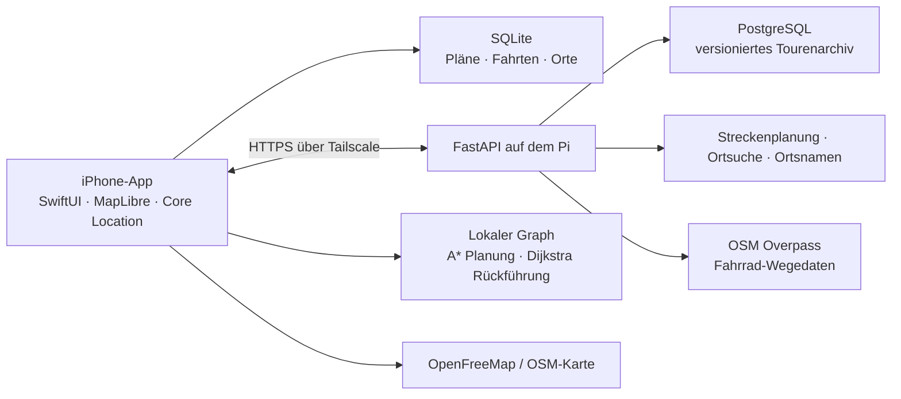
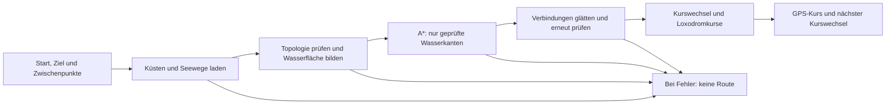

# Architektur

## Auto-Charakter und Tempobegleitung (17. Oktober 2026)

`CarCompanion.swift` kapselt den lokalen Vertrag `CarCharacterPack`, Ereignisse, zeitbasierte Tempobeobachtung und gedrosselte Abweichungsreaktionen. `AppState` fordert das Repertoire bei erfolgreicher Auto-Planung oder explizitem Wechsel asynchron an; Anfragen sind abbrechbar, späte Antworten nach Deaktivierung/ersetztem Auftrag werden verworfen. Die aktive Fahrt bekommt durch eine parallele neue Planung keinen anderen Charakter. Repertoire, Aktivierung und ereignis-/repertoireübergreifende `CarCharacterSpeechHistory` liegen in UserDefaults; keine Tour-/Datenbankmigration. Nur `speakCar` ergänzt die Texte, prüft aktive Auto-Aufzeichnung und den Sprachschalter. Andere Profile bleiben getrennt. Die Spruchhistorie normalisiert Groß-/Kleinschreibung und Satzzeichen, verwirft nach 30 Minuten abgelaufene Einträge und wählt die erste gültige ungesprochene Variante. Ohne freie Variante entfällt der Zusatz. Erst nach erfolgreicher Stimmenwahl und Audioaktivierung wird der ausgewählte Text als verwendet gespeichert; ein späterer Abbruch der bereits eingereihten Ansage gibt ihn vorsichtshalber nicht wieder frei. Kein Zurücksetzen bei Pause, neuer Route oder Charakterwechsel; kein zusätzlicher KI-Abruf.

`CarSpeedGuidance` verknüpft aktuelle und kommende Abschnitte mit derselben Routengeometrie, überbrückt keine unbekannten Limits und wertet GPS-Zeit statt Aufrufhäufigkeit aus. Datenlücken und Pause setzen die Tempobeobachtung zurück, die letzte Auto-Ansage in `AppState` bleibt davon unberührt. Zeitfenster: Vorwarnung 15 s/120–600 m, Überschreitung >3 km/h für 6 s (bei Verzögerung spätestens 12 s), Wiederholung ≥25 s, Mindestabstand zwischen Zusatzansagen 8 s. Seit 19. Oktober benötigen Vorausschau und Limitwechsel zusätzlich mindestens 180 s seit der letzten Auto-Ansage (auch Navigation/Abweichung). `AppState` übergibt dafür `carLastSpeech`; intern bleibt die letzte Tempomeldung auch nach ungültigem GPS erhalten. Überschreitungswarnungen und Bestätigung nach Tempoanpassung sind ausgenommen. Gedrosselte Übergangsmeldungen werden verworfen. Unmittelbare Manöver sperren Tempo-/Charakterzusätze; die sachlichen Abbiegehinweise bleiben priorisiert. Übergangsmeldungen verfallen nach 15 s, statt später ein überholtes Limit zu nennen.

`car_character.py` hängt am authentifizierten Endpunkt `/v1/car/character`. Seit 18. Oktober zehn Rollen bei unveränderten Kennungen der bisherigen sieben. Rollenspezifische Pointenbeispiele und getrennte Ereigniskontexte schärfen den Auftrag: nur der kurze zweite Satz, keine zusätzliche sachliche Ansage. Eine zusätzliche Prüfung neuer KI-Texte verwirft Duplikate, stereotype innere Selbstbeschreibungen, kopierte Stilbeispiele und explizit wiederholte Tempoanweisungen; der bestehende JSON-Vertrag und gespeicherte Repertoires bleiben kompatibel. Die Prüfung ist kein automatischer Humor- oder vollständiger Bedeutungsnachweis. Ein schemaorientierter Responses-Aufruf erstellt drei Varianten je Ereignis; Länge, Satzanzahl und unzulässige Zahlen/Richtungs-/Fahrbegriffe werden zusätzlich geprüft. Der Prompt beschränkt Texte auf persönliche Kommentare, während alle Fahrfakten aus der Navigation stammen. Die Prüfung ist keine vollständige semantische Garantie für generierten Humor. Das Ausgabeschema begrenzt bereits Zeichenlänge und Satzform. Bei ungültigem Text ist genau ein neuer Entwurf innerhalb derselben 30-Sekunden-Frist erlaubt; verbotene Fahrbegriffe werden auch als Metaphern ausgeschlossen. Modellverweigerung, Zeitüberschreitung und erneut ungültige Ausgabe führen zum vollständigen Ersatzrepertoire. Ein Lock und ein monotoner Stundenzähler begrenzen parallele/gehäufte Aufrufe, ohne Persistenz über Prozessneustarts. Rolle wird als opaque Kennung zum Ausschluss beim nächsten Wechsel übertragen und nicht in der UI benannt. Die API akzeptiert keine Fahrtdaten. Konfiguration, Datenschutzumfang und Rückfall: [AUTO.md](AUTO.md#pi-konfiguration-und-rückfall).

## Auto-Assistenz und Stimmen (15. Oktober 2026)

`server/bikenavi/car.py` ergänzt einen optionalen TomTom-Maps-v1-Adapter hinter `ORS.car_route`. Damit verwenden Planung, Neuberechnung und bestehende POI-Zufahrtsprüfungen denselben Pkw-Router. Nur bei vorhandenem `TOMTOM_API_KEY` aktiv; andere Profile bleiben unverändert. Authentifizierter Routenendpunkt, serverseitiger Schlüssel, persistentes atomares Monatsbudget von 19.000 Abrufen und datenbankweiter Mindestabstand von 0,3 Sekunden in `provider_budgets`. Das gemeinsame Abfragetempo gilt auch für POI-Kandidaten und nach Neustarts. HTTP 429 bewahrt seinen konkreten Grund und berücksichtigt `Retry-After` (ohne Angabe zwei Sekunden); Zugangs-/Server-/Netzwerkfehler pausieren 60 Sekunden. Routenbezogene Ablehnungen und Validierungsfehler sperren weitere Kandidaten nicht. Diagnoseausgaben enthalten nur HTTP-Status oder Fehlerklasse, keine Anbieter-URL oder Nutzdaten. Die neue Tabelle `provider_months` enthält ausschließlich Monatskennung und Zähler, keine Suchorte oder Schlüssel. Optionaler Vertrag für Tempoabschnitte, Fahrspuren und Verkehr einschließlich Abrufzeit; alte Daten bleiben lesbar und bestehende Receipt-Hashes erhalten.

`CarRideView` legt die Spurführung als kontrastreiches Karten-Overlay neben das Tempolimit. Gelb, schwarze Empfehlungspfeile und Häkchen unterscheiden empfohlene Spuren auch ohne alleinige Farbcodierung. Autozoom arbeitet ohne Statusbeschriftung weiter. `CarNavigation.rideTrafficNotice` unterdrückt die TomTom-Statuszeile bei frischen Daten ohne Gesamtverzögerung; `nextTraffic` überspringt wirkungslose Abschnitte und behält Sperrungen unabhängig von der Verzögerung. Fehlende/veraltete Daten bleiben als Einschränkung kenntlich.

`AppState.refreshCarTraffic` verwendet eine unabhängige, abbrechbare Aufgabe und aktualisiert frühestens nach fünf Minuten bei aktiver, frischer Routenbindung. `CarNavigation.trafficRefreshDue` prüft sowohl Datenalter als auch letzten Versuch gegen 300 Sekunden; Fehler lösen keinen schnelleren Wiederholungsabruf aus. Kein Streaming; notwendige Neuberechnungen und POI-Zufahrtsprüfungen sind zusätzliche ereignisbezogene Anfragen. Übernahme nur bei unveränderter Fahrt, Route und offenen Zielen sowie erneut passender aktueller Position. Die neue Route wird als `localNavigation.carRoute` gespeichert; alle Zusatzdaten bleiben an deren Geometrie gebunden. `CarNavigation` blendet unpassende/fehlende Daten aus und lässt Verkehr nach fünf Minuten altern. `NavigationVoice` löst Stimmen bei jeder Ansage neu auf, lässt nur deutsche Premium-Stimmen und von iOS angebotene Siri-Stimmen zu, filtert Eddy/Eloquence sowie Apples `isNoveltyVoice` aus und respektiert eine geeignete explizite gespeicherte Auswahl. Automatisch wird Anna Premium bevorzugt; keine Standard-/Enhanced-Stimmen als Rückfall. Ohne geeignete Stimme keine Sprachsynthese mit `nil` oder ungeprüfter Sprachstandardstimme. Die NavigationLink-Auswahlliste aktualisiert sich beim Öffnen, bei App-Rückkehr und `availableVoicesDidChangeNotification`; ausgeschlossene/entfernte Auswahl wird auf Automatisch gesetzt. Stimmenwechsel bricht alte Ansagen/Hörproben ab. Details und verbleibende Aktivierungsgrenzen: [AUTO.md](AUTO.md).

## Profilübergreifende POIs (15. Oktober 2026)

Die POI-Detailkarte setzt `RouteMap.pointOverviewZoom` auf 14. Sowohl der erste Fokus als auch `Coordinator.fit()` nach dem ersten Laden des Stils verwenden diesen Überblick, statt MapLibres automatischer Maximalvergrößerung auf einen einzelnen Marker. Das optionale Verhalten betrifft nur explizit konfigurierte Einpunkt-Karten ohne Route/Track; unveränderte Ansichten behalten ihre Kameralogik. Spätere Stilaktualisierungen setzen einen manuellen Zoom nicht zurück.

Die gemeinsamen POI-Einstiege liegen in `PlannerView`, `RideView`, `CarRideView` und `MarineRideView`. `AppState.poiSearch` übernimmt das tatsächliche Planungs-/Fahrtprofil. Nur Auto erhält einen Routenkorridor und darf `/v1/pois/route` aufrufen; Nicht-Auto-Korridore werden serverseitig zurückgewiesen. Die übrigen Profile nutzen dieselben Anbieter/Caches/Budgets, aber ohne ORS-Pkw-Anfragen. Originalkoordinaten bleiben erhalten, Ergebnisse werden auf den Suchradius begrenzt und tragen optional `airDistance`. `drivingDistance`/`drivingSeconds` bleiben dort aus Kompatibilitätsgründen nullwertig (0), werden aber niemals als Fahrwerte angezeigt.

`POIView` trennt Luftlinien- und Pkw-Ergebnisse sowie die erlaubten Aktionen. Landplanungen verwenden bestehende `addPoint`-/`addPlaceToTour`-Pfade mit unverändertem Profil. Aktive Nicht-Auto-Touren und Seeplanungen erlauben Speichern über `SavedPlaceEditor`, jedoch keine implizite Routenmutation. Die Seeansicht erklärt die Landort-/Anlegestellen-Grenze. Neue iPhone-App und aktualisierter Pi erforderlich; keine Datenbankmigration oder neue Zugangsdaten.

## Auto-POIs und Kraftstoffpreise (15. Oktober 2026)

`POI.swift` enthält Kategorien und Such-/Ergebnisverträge; `POIView` ist die gemeinsame Clay-Seite aus Planung und Autofahrt. `AppState.poiSearch` bindet Fahrtsuchen an aktuelle GPS-/Routendaten. Eine Übernahme berechnet neu und speichert Wegpunkte sowie `carRoute`, verbleibende Ordinale und optional `carPOIStopID` erst nach Prüfung des weiterhin gültigen Fahrtzustands. Die Originalplanung bleibt unverändert. Entfernen berechnet die offenen Ziele ohne den Stopp neu; ein einziges Ziel einer freien Fahrt lässt sich ohne Aufzeichnungsverlust entfernen. Beim Kopieren einer Fahrt mit Ersatzroute muss die Planung neu berechnet werden.

`server/bikenavi/pois.py` kapselt Tankerkönig, E-Control, goriva.si, Min2Go und OSM, verwendet begrenzte RAM-Caches und Anbieter-/Routingabfragen und liefert nie erfundene Preise. `POST /v1/pois/search` und `/v1/pois/route` sind authentifiziert. Routenprojektion filtert vorausliegende Kandidaten; ORS prüft Zufahrt, Weiterfahrt, U-Turns, Rückbewegungen und Zusatzzeit. Anbieter-Schlüssel bleiben auf dem Pi. Das neue Feld `LocalNavigationState.carPOIStopID` ist optional; alte Dokumente bleiben lesbar. Alte Backendfassungen kennen die Endpunkte/das Feld nicht und müssen vor Nutzung aktualisiert werden.

Quelle, Abrufzeit und fehlender Preiszeitstempel bleiben getrennt. Grenzen, konkrete Länderantworten, Dieselzuordnung und Einrichtung: [POI-Bedienung und Quellenprüfung](POI.md).

Die fünf Nicht-Kraftstoffkategorien verwenden jetzt ausschließlich Geoapify Places mit `GEOAPIFY_API_KEY`: ein Kreisabruf, Nähepräferenz, maximal 20 Kandidaten, fünf Minuten RAM-Cache und ein separates atomar gespeichertes Ein-Sekunden-Budget. Die Cache-Sperre serialisiert Abrufe; HTTP-/Netzwerkfehler lösen mindestens 30 Sekunden Pause aus, 401/403 fünf Minuten, längeres `Retry-After` gilt ebenfalls. Private/gesperrte Orte, Bahnsteige, falsche Kategorien, Dubletten, ungültige Koordinaten und Treffer außerhalb des Suchkreises werden verworfen. Fehlender Schlüssel/Quelle und erfolgreich leere Suche bleiben unterscheidbar. Kein automatischer Rückfall auf Overpass; dessen eigener Schutz bleibt allein für preislose Tankstellenstandorte erhalten. Dafür gilt `POI_OVERPASS_URL`, falls gesetzt, sonst `OVERPASS_URL`. Rad-/Seewegdienste bleiben unberührt.

Für Nicht-Kraftstofforte bezeichnet `POIPlace.coordinate` den gerouteten Pkw-Zielpunkt. Ergänzende Antwortfelder `placeCoordinate`, `arrivalCoordinate` und `accessDistance` trennen Datenquellenpunkt, Straßenpunkt und Luftlinienlücke; bestehende Codable-Clients ignorieren zusätzliche Felder und übernehmen weiterhin den korrekten `coordinate`-Punkt. Ab 20 m Abstand steht ein deutlicher Restweg-Hinweis zusätzlich in der vorhandenen Adresse und Ergebnis-Hinweisfläche. Maximal 350 m Suchabstand, keine behauptete Fußverbindung. Bei Routenkontext zuerst Pkw-Endpunkt berechnen, dann als genaues Zwischenziel über sämtliche offenen Ziele routen; Originalort und Endpunkt müssen vorausliegen, maximale Zusatzzeit und Rückfahrts-/Wendekontrolle unverändert. Tankstellen behalten 25 m Genauigkeitsanforderung. Die bereits installierte App sendet bei erneuter Stopproutenprüfung das strengere Kraftstoffprofil, aber bereits den tatsächlichen Pkw-Zielpunkt; ein bei Neuberechnung zu weit verschobener Punkt wird weiterhin abgewiesen.

Tankerkönig verwendet eine eigenständige räumliche RAM-Auswahl: ein 25-km-Abruf, bis zu acht Gebiete, zwei Minuten Wiederverwendung bei vollständiger Abdeckung und höchstens fünf Minuten gekennzeichnete Ausfall-/Teilauswahl. Kein Hintergrund-Polling. `Storage.reserve_provider_request` reserviert den nächsten Zugriff atomar in der additiven Tabelle `provider_budgets`; mindestens 61 Sekunden Abstand, auch bei Fehlern, mehreren Prozessen und Neustart. Der Datensatz enthält nur Anbieterkennung und Freigabezeitpunkt. Keine gespeicherten Preise, Suchorte oder Zugangsdaten. Dieselbe Datenbank und ausschließliche Nutzung des Schlüssels durch diesen Dienst sind Voraussetzung für die gemeinsame Begrenzung. Rückfall auf alte Backendsoftware darf die neue Begrenzung nicht umgehen.

## Tourtagebuch und Blog

`BlogPoint` speichert einen Ort, Zeit, Titel, Notiz, optionale Reihenfolge, letzte bestätigte Pi-Revision und optional ein auf dem iPhone neu encodiertes JPEG. `LocalStore` hält Punkte und HTML-Entwürfe getrennt pro Fahrt; beim Löschen einer Fahrt werden diese Daten lokal entfernt. Nach dem Fahrtdokument synchronisiert `AppState` idempotente neue und geänderte Punkte mit dem Pi und ruft sie seitenweise wieder ab. Der Pi akzeptiert Punkte ausschließlich zu vorhandenen Fahrten und begrenzt sie auf 50 Punkte, 768 KB je Bild und 20 MB insgesamt.

`BlogGenerator` erzeugt für eine beendete, vollständig synchronisierte Fahrt eine portable HTML-Fassung mit eigener SVG-Streckenkarte, Höhenprofil, Bildern sowie begrenzter Wikipedia- und OpenTopoMap-Recherche. Ohne beide optionalen Umgebungsvariablen `BLOG_OPENAI_API_KEY` und `BLOG_OPENAI_MODEL` bleibt es bei einem lokalen Vorlagenentwurf. Mit ihnen analysiert zunächst ein Responses-Schritt alle Stationsfotos gemeinsam mit Titel/Koordinaten und liefert je Stations-ID validierte Suchhinweise, lokale Wikipedia-Sprachcodes und Unsicherheiten. Fotos gehen ausschließlich an diesen Analyseschritt; die daraus abgeleiteten Hinweise sind keine Faktenquellen. Ohne Fotos werden Standort-/Sprachhinweise ermittelt. Wikipedia durchsucht zuerst die vorgeschlagenen lokalen Sprachen, ergänzt Deutsch/Englisch und dedupliziert Sprachfassungen über Wikidata-IDs. Ein eigener Websuchschritt prüft Bildhinweise gegen Standort und Quellen, bevorzugt nahe Objekte (auch große Seen mit entferntem Mittelpunkt) und sucht zusätzlich in der Landessprache. Der Schreibschritt bekommt Stations-IDs/-koordinaten, Hinweise, Notizen, geplante Höhenwerte und belegte Quellen; er soll Hintergründe erzählen statt Foto/Titel/Originalnotiz zu wiederholen. Vollständige GPS-Spuren werden nicht an OpenAI übergeben. HTML-Vorschauen deaktivieren JavaScript. Additive Tabellen, Datenübertragung, Konflikte, konsistente Erstellung und Betriebsgrenzen: [BLOG.md](BLOG.md).

BikeNavi besteht aus einer nativen iPhone-App und einem privaten Backend auf einem Raspberry Pi. Das iPhone bleibt während einer Fahrt handlungsfähig: Es hält Planung, Route und Aufzeichnung lokal vor. Mit eingerichtetem Pi berechnet openrouteservice die Strecke; das iPhone berechnet lokale Rückführungen in einem mitwandernden 3-km-Umkreis selbst. Ohne API-Client bleibt lokale Planung aus gespeicherten Gebietsdaten möglich. Der Pi liefert Wegedaten, führt die Ortssuche aus und hält das zentrale Tourenarchiv.



## iPhone

`ios/BikeNavi/` enthält die SwiftUI-Oberfläche. `AppState` bündelt den Planungszustand, die lokale Speicherung, Standortupdates, Navigation und die Synchronisation. Views verändern keine Datenbank direkt.

`AppState.openRide()` startet auch ohne berechnete Planung eine Fahrt. Dafür entsteht ein eigenständiges `TourDocument` mit dem gewählten Profil, ohne Route, Wegpunkte, `sourcePlanID` oder lokalen Navigationszustand; die Planung bleibt erhalten. GPS-Filterung, abschnittsweise Aufzeichnung, Pausen, Wiederherstellung und Speicherung verwenden denselben Pfad wie geplante Fahrten. Der Start übergibt den vorhandenen frischen GPS-Fix ebenfalls an den bestehenden Trackfilter; ein geeigneter Fix wird sofort als erster Trackpunkt gespeichert. Ohne Route werden keine Navigationsfortschritte oder Rückführungen berechnet; Fahrtansicht und Live-Aktivität zeigen „Freie Fahrt“ statt Routensuche. Die Fahrtansicht zeigt bereits während der GPS-Suche die Karte.

Der Fahrtstart gleicht den Standortzugriff mit der aktuellen Core-Location-Berechtigung ab. Ein Fehlercallback allein setzt keine dauerhafte Zugriffssperre. Der Start verwendet eine höchstens 15 Sekunden alte Position mit maximal 100 m gemeldeter Ungenauigkeit und wartet sonst bis zu 15 Sekunden auf einen geeigneten Fix. Mehrfachtippen erzeugt keinen zweiten Start. Abbruch, Tabwechsel, Verlassen des aktiven App-Zustands und Änderungen der Planungs-/Routen-ID verwerfen den ausstehenden Start; verspätete Messungen starten dann keine Fahrt. Bei Rückkehr in den Vordergrund wird der Standortdienst erneut angefordert. Zeitlimit und tatsächlich verweigerte Berechtigung haben getrennte Meldungen. Die Wartezeit wird mit einer monotonen Uhr gemessen.

Die Einstellungen betten Apples `MPVolumeView` über `UIViewRepresentable` ein und verändern damit direkt die System-Medienlautstärke. `AppState` beobachtet `AVAudioSession.outputVolume` während der sichtbaren Einstellungen per KVO; Änderungen ersetzen nach 180 ms die Kinderreim-Hörprobe. Navigation und Hörprobe verwenden `AVSpeechUtterance.volume = 1`, ohne zusätzlichen Lautstärkefaktor. Der frühere lokale Schlüssel `speechVolume` wird entfernt. Beim Verlassen der Ansicht bzw. Hintergrundwechsel werden Beobachtung und Probe beendet; Navigation beendet eine laufende Probe. Der Simulator zeigt ausdrücklich einen Verfügbarkeitshinweis statt eines funktionslosen Ersatzreglers. Systemlautstärke und Hardwaretasten sind am Gerät zu prüfen. Referenz: [Apples MPVolumeView-Dokumentation](https://developer.apple.com/documentation/mediaplayer/mpvolumeview).

`ios/BikeNavi/Core/` ist bewusst ohne UI aufgebaut und wird als Swift Package getestet:

| Baustein | Verantwortung |
| --- | --- |
| `Models.swift` | Planungen, Fahrten, Wegpunkte, Favoriten, Routen und Profile |
| `LocalStore.swift` | Dauerhafte SQLite-Speicherung auf dem iPhone |
| `APIClient.swift` | Authentifizierte HTTPS-Aufrufe an den Pi |
| `Navigation.swift` | Routenprojektion/Magnet, Fortschritt, GPS-Filter und Regel für Neuberechnung |
| `LocalRouter.swift` | Lokale Planung und Anschluss plus verbleibende Route |
| `OfflineRoutingStore.swift` | Versionierte Wegedaten, Download, Graph-Wiederverwendung |
| `GPX.swift` | Export abgeschlossener Fahrten |

MapLibre zeichnet die Karten, Wegpunkte, Aufzeichnung und Routenabschnitte. `RouteMap.Coordinator` verwaltet Route (einschließlich Abstellmarker), Aufzeichnung, Wegpunkte und Favoriten als getrennte Annotationsgruppen. Neue Trackpunkte ersetzen ausschließlich die Aufzeichnung; die unveränderte Route und der Navigationsmarker bleiben registriert. Geometrieänderungen bei gleicher Routen-ID werden erkannt. Nach einem geladenen Kartenstil werden alle Gruppen ausdrücklich erneuert; neue Annotationen werden vor dem Entfernen ihrer Vorgänger registriert. Route und Abbiegehinweise verwenden gespeicherte Geometrie und benötigen keinen laufenden Netzwerkabruf. Belagsinformationen sind an Geometrie-Indizes gebunden. Fehlen diese Indizes bei einer älteren Route, bleibt ihre Linie grau statt Beläge zu erraten. Neue lokale Planungen gewinnen Kreuzungsarme aus dem gespeicherten OSM-Graphen. Die App speichert diese Kreuzungsgeometrie in der Route und zeichnet sie ohne Karten- oder Netzwerkzugriff in der Live-Aktivität.

Die Fahrtansicht hält den Standort bei 80 % der Kartenhöhe und kalibriert den Maßstab auf 500 m bis zum oberen Rand. Die Kamera fordert die maximale Neigung von 60° an; MapLibre begrenzt sie zusätzlich für den versetzten Mittelpunkt. Bei Bewegung verwendet die Karte den aktuellen GPS-Kurs, im Stand oder bei langsamer Fahrt den Kompass. Manuelle Kartenänderungen pausieren die Nachführung für zehn Sekunden; die Rückkehr benötigt keinen neuen GPS-Punkt. Bis 25 m Abstand rastet die Anzeige bei passender Genauigkeit und Richtung auf der Route ein. Eine bestätigte Abweichung ab 35 m über fünf Sekunden und mindestens drei genaue Messungen startet die lokale Anschlussberechnung. Sie minimiert Anschluss plus verbleibenden Originalweg, wahrt offene Zwischenziele und hat ein Suchbudget von zwei Sekunden. Nach zehn Sekunden darf erneut gerechnet werden. Details und Grenzen: [LOKALE_NEUBERECHNUNG.md](LOKALE_NEUBERECHNUNG.md).

## Pi-Backend

`server/bikenavi/` ist eine FastAPI-Anwendung. Sie läuft zusammen mit PostgreSQL in einem eigenen Docker-Compose-Projekt. Der HTTP-Port ist nur über Loopback erreichbar; Tailscale Serve stellt den privaten HTTPS-Zugang bereit.

| Endpunkt | Zweck |
| --- | --- |
| `GET /health` | Gesundheitsprüfung ohne Zugangsdaten |
| `GET /v1/status` | Routing- und Serverstatus |
| `POST /v1/route` | Streckenplanung über ORS; aktuelle App mit `include_context=false` |
| `GET /v1/offline-tiles/{x}/{y}` | Gespeicherte OSM-Fahrradgraphen für die lokale Suche |
| `GET /v1/search` | Orts-, Adress- und POI-Suche |
| `GET /v1/place-name` | Name für einen Kartenpunkt |
| `POST /v1/mutations` | Versioniertes Speichern einer Planung oder Fahrt |
| `GET /v1/changes` | Abgleich seit einer Serverrevision |

Jede Änderung hat eine Mutation-ID und eine Basisrevision. Wiederholte Übertragungen erzeugen keine Dublette. Treffen widersprüchliche Änderungen aufeinander, bewahrt die App die lokale Fassung als Kopie, statt still zu überschreiben.

## Daten und Sicherheit

Die App speichert den API-Zugang im iOS-Schlüsselbund. Der ORS-Schlüssel bleibt ausschließlich in der `.env` des Servers. `.env`, Datenbanken, Testausgaben, Backups und Build-Ergebnisse gehören nicht in Git.

`MapStyle` definiert die Kartenansichten Standard (Liberty DE), Hell (Positron), Detailreich (Bright), Dunkel, Satellit (Esri World Imagery), Topografisch (OpenTopoMap), Seekarte (OpenSeaMap) und eigener Kartenstil. `AppState.selectedMapStyle` bleibt ausschließlich im Arbeitsspeicher und wird beim Öffnen einer Anwendung gesetzt: Standard für Fahrrad/Auto/Kombination, Topografisch für Wandern, Seekarte für Segeln. Die separat gespeicherte eigene Stiladresse bleibt erhalten; die aktive Auswahl wird nicht persistiert und bei Rückkehr aus dem Hintergrund nicht zurückgesetzt. Alle `RouteMap`-Ansichten verwenden dieselbe abgeleitete Stiladresse. Die drei Rasterstile liegen als JSON-Ressourcen im App-Bundle, eingebunden durch den Projektgenerator; Quellenattribution und maximale Quellzoomstufen (19/17/18) sind darin enthalten. `seamap.json` kombiniert die OpenStreetMap-Grundkarte von `https://t2.openseamap.org/tile/{z}/{x}/{y}.png` mit der transparenten Seezeichenebene `https://tiles.openseamap.org/seamark/{z}/{x}/{y}.png` (je 256 px, XYZ, HTTPS, Quellmaximum 18). Die Seezeichen liegen über der Grundkarte; Routen-/Positionsannotation und Kamera verwenden denselben bestehenden Pfad. Quellen und Hinweis auf amtliche Seekarten stehen in der Attribution, zusätzlich in den Einstellungen. Keine Tiefenkartenebene oder Offline-Paketfreigabe. Das Seeweg-Profil und die maritime Darstellung sind im folgenden Abschnitt beschrieben. Beim Stilwechsel werden Annotationen nach dem Laden neu gezeichnet; nur der erste Stil lädt die anfängliche Routenübersicht, spätere Wechsel erhalten den Kartenausschnitt. Navigation behält ihre Kamera-Nachführung. Öffentliche Ansichten sind vom Offline-Paketdownload ausgeschlossen, selbst wenn dessen Schalter aktiv ist. Nur ein gewählter eigener HTTPS-Kartenstil kann freigegeben werden.

Die Standard-Grundkarte basiert auf OpenStreetMap-Daten und wird über OpenFreeMap geladen. Vollständige Offline-Kartenpakete und ein eigener Kartenserver sind noch nicht produktiv eingerichtet. Bereits gespeicherte Routen, Abbiegehinweise und GPS-Aufzeichnung funktionieren ohne erneute Routenberechnung weiter.

## Betrieb und Prüfungen

Lokale Tests:

```sh
.venv/bin/python -m pytest server/tests -q
swift test --scratch-path build/SwiftTests
```

Für den Pi stehen `scripts/deploy_pi.py`, `scripts/check_pi.py` und `scripts/backup_pi.py` bereit. Die genaue Einrichtung, Umgebungsvariablen und Sicherheitsgrenzen stehen in der [README](../README.md).

### Revision der Wegenetzaufbereitung

Offline-Kacheln behalten Schema-Version 1 und enthalten zusätzlich `compilerRevision: 3`. Der Pi trennt Cacheeinträge nach Schema, Compilerrevision und Gebiet (`1/3/x/y`), damit alte Ergebnisse ohne OSM-Knotenversionen nicht weiter ausgeliefert werden (Revision 2 korrigierte zuvor die Schrankenauswertung). Ältere Clients können das zusätzliche Feld ignorieren. Neue Clients lesen fehlende Revisionen als Altbestand und erneuern sie beim Vorbereiten mit API-Client; diese Prüfung umfasst Routenmanifeste, Gebietreferenzen und den vorbereiteten Graphen. Ohne API-Client sowie beim direkten Laden gespeicherter Touren bleiben Altbestände lesbar. Unveränderliche Dateien und atomare Manifeste erhalten bestehende Offline-Pakete bei fehlgeschlagenen Downloads. App und Pi müssen für die automatische Migration aktualisiert werden.

Die Overpass-Abfrage verwendet `out meta`; nur die positive OSM-Knotenversion wird als optionales `osmVersion` übernommen, keine Bearbeiternamen oder Benutzerkennungen. Bei widersprüchlichen Positionen desselben Knotens gewinnt die höhere OSM-Version, unabhängig vom Downloadzeitpunkt. Zugangsausschlüsse bleiben konservativ. Ohne eindeutige Version wird einmal das gesamte benötigte Gebiet mit `refresh=true` erneuert; bleibt der Konflikt bestehen, erscheint eine eigene Kartenstand-Fehlermeldung. Das bestehende Routenmanifest wird erst nach erfolgreichem Graphaufbau ersetzt.

### Höhenanreicherung nach lokaler Planung

`Core/RouteElevation.swift` tastet die unveränderte Route entlang ihrer kumulierten Weglänge mit etwa 30 m Abstand ab (maximal 2.000 Punkte), glättet validierte Höhen und berechnet Anstieg/Abstieg. `AppState` lädt fehlende Profile als separate, abbrechbare Hintergrundaufgabe nach Berechnung und beim Öffnen. Plan- und Routen-ID sowie Anfrage-ID verhindern, dass verspätete Antworten andere Planungen überschreiben. Ein Fehler blockiert weder Planung noch Navigation; vorhandene Profile benötigen keinen erneuten Download.

Der authentifizierte Endpunkt `POST /v1/elevation` nimmt 2–2.000 Koordinaten entgegen. `server/bikenavi/elevation.py` ruft ausschließlich den festen ORS-Elevation-Endpunkt auf und prüft Anzahl, Reihenfolge, Position und endliche Höhen (-500 bis 9.000 m). ORS kann einzelne Höhenpunkte auslassen. Die Antwort wird anhand ihrer Koordinaten als geordnete Teilfolge zugeordnet. Nur innere Lücken mit höchstens zwei fehlenden Punkten, maximal 100 m zwischen den umschließenden gültigen Werten und insgesamt höchstens acht fehlenden Punkten werden entlang der Distanz linear interpoliert. Die Quelle nennt die Anzahl ergänzter Punkte. Fehlende Randwerte, größere Lücken, verschobene oder ungültige Antworten sowie Dienstfehler werden als 503 ohne Weitergabe von Schlüssel oder Upstream-Fehlerdetails behandelt. Die App übernimmt nur vollständige Antworten. Der ORS-Schlüssel bleibt auf dem Pi.

`CalculatedRoute`/`Route` erhalten die optionalen Felder `elevationProfile` (Distanz-/Höhenpaare) und `elevationSource`. Alte Touren bleiben lesbar. SQLite-Speicherung und PostgreSQL-Synchronisation übernehmen beide Felder; Datenbankmigrationen sind nicht erforderlich. Die Originalkoordinaten erhalten interpolierte Höhen für GPX, ihre Zahl und alle Indexbezüge bleiben erhalten. Die Anzeige erkennt verfügbare Höhen anhand der Daten statt anhand des Provider-Namens. Beim Kombinieren oder Kürzen lokaler Rückführungen werden nicht mehr gültige Profile und Summen verworfen.

Dienstreferenzen: [API und SRTM-Datenquelle](https://github.com/GIScience/openelevationservice), [ORS-Abfragelimit](https://openrouteservice.org/restrictions/).

### Zwischenziele während einer Abweichung

`LocalNavigationState.skippedWaypointOrdinals` speichert optional die ausdrücklich ausgelassenen Zwischenziele anhand ihrer Position in der Wegpunktliste. Fehlende Werte in älteren Fahrten bedeuten keine ausgelassenen Ziele. Originalgeometrie, Planung und aufgezeichnete GPS-Punkte werden dadurch nicht geändert. Das Backend erhält das optionale Feld ebenfalls, damit die Synchronisation die Entscheidung bewahrt; Start und Fahrtziel sind dort als übersprungene Ziele unzulässig. `LocalRouteMetrics` verwendet diese Liste sowohl bei der lokalen Anschlusssuche als auch bei der Rückkehr zur Originalroute; das letzte Ziel bleibt verpflichtend.

Nach der bestehenden GPS-Abweichungsbestätigung bietet `AppState` das nächste offene Zwischenziel an. Eine globale, richtungsabhängige Projektion auf die Originalroute kann mehrere bereits hinter der Position liegende Ziele gemeinsam anbieten. Die Zustimmung wird vor der Neuberechnung gespeichert; ein alter Anschluss wird verworfen. Bei Abweichung beziehungsweise direkt nach der Zustimmung darf eine globale Projektion den begrenzten Tracker-Suchbereich verlassen, jedoch nicht über das nächste weiterhin verpflichtende Ziel hinaus. Im normalen Fahrbetrieb bleibt das lokale Tracker-Fenster erhalten. Ablehnungen werden für die laufende App-Sitzung unterdrückt. Der Dialog verändert keine Ziele ohne Tastendruck.

## Lange Strecken und mitwanderndes Umfeld (24.09.2026)

`OfflineRoutingStore.calculate` nutzt bei eingerichtetem API-Client `/v1/route?include_context=false`. Diese Option überspringt die bisherige optionale Overpass-Anreicherung der gesamten Strecke; der Standardwert bleibt für ältere Clients `true`. Routenberechnung und Speicherung sind unabhängig von `prepareNeighborhood`. Fehlende lokale Daten können daher keine erfolgreich berechnete Serverroute mehr verwerfen. Routingprofil und Zwischenziele werden unverändert an den bestehenden Anbieterpfad übergeben; dessen Belagsprüfungen bleiben aktiv.

ORS-Routenaufrufe erhalten 75 Sekunden Lesezeit und 10 Sekunden Verbindungszeit. Bis zu zwei Profilkandidaten werden parallel angefragt und anschließend nach den bisherigen Belagsregeln ausgewertet. Eine gemeinsame Grenze von 80 Sekunden bricht ausstehende Anbieteranfragen ab; die App wartet 90 Sekunden. Diese Grenze gilt für die Anbieterphase, nicht für die optionale Kreuzungsanreicherung älterer Clients. Ortssuche und sonstige Dienste behalten ihre bisherigen Zeitlimits. Hintergrund: Eine öffentliche Beispielroute Rodgau–Göteborg benötigte bei der Prüfung am 25.09.2026 direkt bei ORS 60,5 Sekunden; der bisherige Pi-Aufruf brach bereits nach 35,1 Sekunden ab.

`OfflineTileID.neighborhood` wählt die Kacheln im 3,5-km-Fenster um die GPS-Position (3 km Suchradius plus 500 m Vorlauf). `AppState` prüft die Abdeckung bei genauen, frischen GPS-Messungen und lädt fehlende Bereiche mit höchstens einem laufenden Fahrt-Task und mindestens 30 Sekunden zwischen Versuchen. Fahrt-ID, Request-ID und Aufzeichnungszustand sichern die Ergebnisübernahme. Pause und Ende brechen den Download ab. Ein vollständiges neues Fenster ersetzt Graph und Routenmanifest atomar; Fehler erhalten das vorherige Paket. Die Manifeststruktur bleibt kompatibel, ihre Semantik ist jetzt ausdrücklich eine lokale Teilabdeckung. Alte Pakete bleiben lesbar.

Der Cache bleibt auf 250 MB begrenzt. Vor einem Download werden nötigenfalls alte, nicht mehr referenzierte Dateien entfernt; Manifeste und aktive Downloads schützen ihre Dateien. Die Suchgrenze von 3 km wird weiterhin im lokalen Router durchgesetzt, auch wenn vollständige OSM-Wege über eine Kachel hinausreichen. Ohne Netz kann das Fenster nur aus gespeicherten Kacheln erweitert werden. Alte Belagsdaten werden nur dann aus dem Graphen repariert, wenn alle Routenpunkte in dessen Kacheln liegen.

### Lokale Koordinaten- und Plus-Code-Suche

`SearchView` prüft vor dem API-Aufruf `PlusCode` und `CoordinateParser` im Swift-Core. WGS84-Dezimalgrad, Grad/Minuten und Grad/Minuten/Sekunden werden normalisiert, vollständig geparst und auf gültige Winkelbereiche geprüft. Kandidaten werden dedupliziert; einfache Dezimalgradpaare haben Vorrang vor unmarkierten Untereinheiten. Verbleibende Mehrdeutigkeit und widersprüchliche Vorzeichen/Himmelsrichtungen erzeugen einen Hinweis. Zahlen ohne Trennzeichen bleiben für die normale Postleitzahlensuche verfügbar. Alte Treffer werden vor jeder Suche gelöscht; parallele Suchstarts sind gesperrt.

`PlusCode` decodiert vollständige Open Location Codes lokal einschließlich Padding und Präzisionsraster. Verkürzte Codes werden nach dem Open-Location-Code-Verfahren relativ zu jedem über `APIClient.search` gefundenen Bezugsort ergänzt. Gesucht wird nur der Ortsname, ohne GPS-Nähefilter. Der Nutzer wählt den resultierenden Treffer. Die Geometrie ist jeweils die Zellmitte. Grundlage: [Open Location Code Specification](https://github.com/google/open-location-code/blob/main/Documentation/Specification/specification.md). Keine neuen Backend-Endpunkte oder Datenformate.

## Rad-/Wanderplanung (5. Oktober 2026)

`RidingProfile.travelMode` / API `Profile.travelMode`: optional `cycling`, `bikeAndHike`, `hiking`; fehlend bedeutet Rad. Swift lässt die Standardauswahl beim Kodieren weg. Neue Serverfelder werden bei `None` aus dem Mutation-Hash entfernt, damit alte Synchronisationsquittungen gültig bleiben.

`server/bikenavi/hiking.py` kapselt ORS `foot-walking` mit `traildifficulty`: vollständige, aufeinanderfolgende Geometriebereiche erforderlich, nur Werte 0 (kein Tag) und 1 (T1) erlaubt. Fahrrad-Belagspolitik und Steigungsgewichtung gelten ausschließlich im Radanteil. Fußziele werden höchstens 20 m versetzt; am Übergang beträgt die Join-Toleranz 1 m. Ohne Verbindung wird keine Luftlinienkante erzeugt.

Kombinationssuche: zunächst vollständige Radroute mit lückenloser ORS-Wegartenprüfung (allgemeiner Pfad 4, Fußweg 7 und Treppe 8 erfordern Wanderanteil; Radweg 6 bleibt erlaubt) und Prüfung aller tatsächlichen Wegpunktpositionen (20 m Toleranz); sonst einfache Wanderroute vom letzten Zwischenziel/Start zum Ziel. Bei mehr als 10 km Luftlinie vom letzten Rad-Wegpunkt startet die Wanderannäherung an einem per ORS-Snap gefundenen Radpunkt im 5-km-Zielumfeld, damit lange Rad-Anfahrten kein Wander-Distanzlimit überschreiten. Bis zu 100 Suchpunkte entlang der letzten 10 km, ORS `/v2/snap/{cycling-profile}/json` mit 100 m Radius, Deduplizierung auf 10 m, höchstens acht Kandidaten. Suchpunkte auf Fußwegen/Pfaden/Treppen verbrauchen keinen Kandidatenplatz; der exakte Beginn eines solchen Abschnitts wird aufgenommen. Bei strenger Belagswahl begrenzen Geometriedistanzen und Belagsbereiche der Wanderreferenz die Suche auf Präfixe mit höchstens 125 m nicht bekannt befestigtem Belag (25 m Schätzmarge, keine Freigabe; tatsächlicher Radpräfix weiter höchstens 100 m außerhalb der begrenzten Straßen-Belagslücken). Vier nächste und bis zu vier über die weitere Zufahrt verteilte Kandidaten verhindern, dass die Suche nur im unbefestigten Zielbereich stattfindet. Die Wegartenprüfung gilt auch für jeden tatsächlichen Radpräfix vor der Auswahl nach Belägen. Für jeden Kandidaten tatsächliche Radroute über sämtliche Zwischenziele und Fußroute zum Ziel berechnen; kleinste Fußdistanz, bei Gleichstand kleinste Gesamtstrecke. Globale Optimalität und geeignete Abstellmöglichkeiten sind nicht zugesichert. Ein gemeinsames 80-Sekunden-Limit begrenzt den Anbieterablauf. Kandidaten ohne Verbindung werden verworfen; Anbieter-/Kontingentfehler werden weitergegeben. Bei `pavedOnly` gilt das gesamte 100-m-Budget nur für den Radpräfix. Sind geprüfte Anschlüsse vorhanden, aber kein Präfix zulässig, kann bei genau zwei Wegpunkten die einfache Wanderannäherung als vollständig gewanderte Route mit ausdrücklicher Begründung zurückgegeben werden. Zwischenziele werden nicht stillschweigend in einen Fußanteil verlegt.

`CalculatedRoute` / API `Route` speichern optional `walkingStartIndex`, `walkingDistance`, `cyclingDistance`. Alle drei sind gemeinsam erforderlich und werden gegen Geometrie/Gesamtlänge validiert. `walkingStartIndex == 0` bedeutet reine Wanderung, sonst Übergang zum finalen Fußrest. Belags-, Manöver- und Wegpunktindizes werden beim Zusammenfügen verschoben; Entfernung, Dauer, Höhen und Belagsanteile summiert. `bicycleParking` leitet die Markerkoordinate aus der gespeicherten Geometrie ab. Alte Routen enthalten keine neuen Felder.

OfflineGraph bleibt ein Fahrradgraph. `LocalRouter` und `OfflineRoutingStore` lehnen lokale Wander-/Kombinationsplanung ausdrücklich ab. `AppState` lädt für diese Profile keine Fahrrad-Umfelder und startet keine Fahrrad-Rückführung. Die gespeicherte Route, Routenfortschritt, Aufzeichnung und Navigation laufen weiter offline. Der Abstellpunkt erscheint in Planung und Fahrt; ein Manöver kündigt den Übergang an. Es gibt keine automatische Rückroute zum abgestellten Rad.

Freie Wanderübersicht: [Waymarked Trails](https://hiking.waymarkedtrails.org/), ebenfalls OSM-basiert; externer Link im Profil. Keine Änderung an OpenFreeMap/MapLibre, kein Rasterkachel-Massendownload. [ORS-Filter](https://giscience.github.io/openrouteservice/technical-details/tag-filtering) und [ORS-Snapping](https://giscience.github.io/openrouteservice/api-reference/endpoints/snapping/) sind die Anbietergrundlage. Fehlende OSM-Wege/Tags bleiben eine Datengrenze.

### POIs außerhalb des Wegenetzes (Korrektur am 5. Oktober 2026)

Die ursprüngliche 20-m-Grenze blockierte Wander-/Kombinationsplanung für POIs im Inneren eines Geländes. Fußplanung verwendet jetzt maximal 500 m Suchradius für POI-Start, Zwischenpunkte und Ziel; echte Rad-/Fußübergänge bleiben auf 1 m begrenzt. Bei mehr als 20 m Zielabstand wird `Route.unmappedDestinationDistance` (Luftlinie, 20–500 m) gespeichert und angezeigt. Startabstände erscheinen in den Warnungen. Die Linie endet am tatsächlichen Netzpunkt; es wird keine Verbindung zum POI konstruiert.

Bei erfolgreicher Radanfahrt und gleichem letzten Rad-/Fußnetzpunkt vor dem Ziel liefert der Kombinationsmodus diese Radanfahrt mit Abstellmarker am terminalen Geometrieindex, `walkingDistance = 0` und explizit unerfasstem Zielzugang. Der terminale `walkingStartIndex` ist nur mit `unmappedDestinationDistance` und Fußdistanz 0 gültig. Null-Fußdistanz wird in der UI durch „Fußrest nicht berechnet“ ersetzt; fehlender Zugang und Kletterfreiheit sind nicht bestätigt. Erfasste Strecke/Zeit enthalten den fehlenden Zugang nicht. Altbestands-Quittungshashes lassen das neue Feld bei `None` weg.


## Aktuelle HeiGIT-Endpunkte und Anfragepuffer (5. Oktober 2026)

Routing und Snap verwenden `https://api.heigit.org/openrouteservice/v2/…`, Ortsnamen `https://api.heigit.org/pelias/v1/…`, Höhen `https://api.heigit.org/openelevationservice/v0/line`. Die alte ORS-Adresse antwortete beim Nutzer mit HTTP 403 und `Quota exceeded`; der Betreiber reduziert dort das Kontingent seit der angekündigten Migration. Der bestehende Schlüssel funktioniert am aktuellen Endpunkt.

ORS puffert ausschließlich erfolgreiche POST-Antworten für Directions und Snap pro Backendprozess im Arbeitsspeicher: Schlüssel aus Pfad und vollständigem sortiertem JSON-Anfragekörper, monotone Lebensdauer 300 Sekunden, maximal 128 Einträge, ältesten Eintrag bei Überschreitung entfernen. Deep Copies verhindern, dass Parsing/Manipulation den Puffer verändert. Keine Speicherung der privaten Koordinaten auf Platte, keine Fehlerantworten im Puffer. Für abgewiesene Radpräfixe wird keine separate Fußroute mehr angefragt. Ein ausdrückliches HTTP-403-`Quota exceeded` wird als Kontingentfehler mit klarer Meldung behandelt, andere 401/403 bleiben Zugangsstörungen. Die öffentliche API bleibt `no-store`.


## Begrenzte Toleranz für Straßen-Belagslücken (5. Oktober 2026)

Die Onlineprüfung bei `pavedOnly` toleriert zusätzlich fehlende `surface=0`-Angaben zwischen unmittelbar angrenzenden bekannten befestigten Abschnitten. Alle betroffenen Geometriekanten einschließlich beider Nachbarkanten müssen in vollständiger ORS-Wegarteninformation Straßen (2/3) sein. Einzelne Lücke höchstens 250 m Geometriedistanz, alle geeigneten Lücken höchstens 500 m zusammen. Werden 500 m überschritten, keine zusätzliche Freigabe. Ohne vollständige Wegarten, ohne beidseitig befestigte Nachbarn, bei Anfang/Ende der Route, fehlenden Surface-Bereichen oder tatsächlich unbefestigten Belägen gibt es keine Ausnahme. Abzug höchstens bis zur ausdrücklich gemeldeten unbekannten Surface-Summenlänge; nicht gemeldete Entfernung bleibt im 100-m-Budget.

`road_gap_edges` wird auch auf die Wanderreferenz für die Kandidatenfilterung angewandt; endgültige Freigabe immer anhand jeder tatsächlichen Radroute. Rohbeläge und Routensummen werden nicht umklassifiziert; eine Routenwarnung nennt die tolerierten unbekannten Meter. Kletter-/Wegartenprüfung unverändert. Das lokale Offlinegraphformat enthält keine entsprechenden Wegarten und der lokale Radrouter bleibt vorsichtiger beim bisherigen 100-m-Budget; Kombinationsplanung erfolgt ohnehin online. Der Profiltext erklärt diese Grenze.


### Blogaktionen und Ortsposition im Stand (6. Oktober 2026)

`RideBlogActions` bündelt Erzeugung, Abruf/Vorschau und HTML-Export; dieselbe Ansicht steht direkt nach den Kennzahlen einer gefahrenen Tour und vor den Bildern im Tourtagebuch. Eine lokale Fassung bleibt ohne Pi abrufbar, beim Öffnen wird gegebenenfalls die neueste Pi-Fassung übernommen. Erzeugung bleibt an eine beendete und vollständig synchronisierte Fahrt gebunden.

`LocationService.journalCoordinate` erneuert einen veralteten Fix für einen Blog-Stopp: Ortung neu starten, vorübergehend keinen Bewegungsfilter einsetzen, bis zu 15 Sekunden auf einen zulässigen Fix warten. Danach den Filter anhand des aktuellen Fahrtzustands wiederherstellen. `BlogPointEditor` übernimmt das Ergebnis asynchron und behält Foto/Notiz bei Fehlern. Der Standort bleibt nach Übernahme am Moment verankert.


### Erzählte Hintergründe (6. Oktober 2026)

Das serverinterne `Story`-Schema enthält zusätzlich bis zu vier `BackgroundChapter`-Objekte mit Überschrift und Text. Der Hauptteil entsteht auch bei `stops=[]` aus recherchierten Kapiteln. Mehrere Absätze werden als escaped HTML-Absätze ausgegeben; Quellenverweise bleiben verlinkt. Das iPhone-/Pi-API-Format des HTML-Entwurfs bleibt unverändert. Die KI erhält zusätzlich die tatsächlich aufgezeichnete Distanz und geplante Wegpunktnamen, um Aufzeichnung und Plan nicht zu verwechseln.


`BlogRepository.research_sources` übernimmt Quellen aus einer quellenreichen vorherigen Fassung derselben Fahrt: bevorzugt das neue Feld `researchSources` in den Entwurfsmetadaten, bei älteren Fassungen ausschließlich `li#source-*` der Quellenrubrik. Persönliche Notizen und Haupttext werden nicht als Belege übernommen. Neu recherchierte Quellen werden per URL zusammengeführt; kurze neue Auszüge verdrängen keine reicheren gespeicherten Hintergründe. Das Entwurfsformat bleibt für ältere iPhone-Clients lesbar, unbekannte Metadatenfelder werden ignoriert.

### Stationen nachtragen und bearbeiten (7. Oktober 2026)

`BlogPointEditor` wird im Tourtagebuch als Neuaufnahme aus einem Bild oder mit einem vorhandenen `BlogPoint` geöffnet. `BlogPhotoLocation` liest mittels ImageIO ausschließlich gültige GPS-Koordinaten aus den Originaldaten, bevor die JPEG-Neucodierung alle Bildmetadaten entfernt ([Apple: GPS-Metadaten](https://developer.apple.com/documentation/imageio/gps-dictionary-keys?language=objc)). Nachträge benötigen Bild-GPS, bestehende Stationen behalten bei Fotos ohne GPS ihren Ort. Laufende Fahrtstopps nutzen weiterhin den aktuellen GPS-Fix.

`LocalStore.saveBlogPoint(_:at:)` hält ID und Aufnahmezeit stabil, speichert Text/Bild und normalisierte `sortOrder`-Werte in einer SQLite-Transaktion und markiert nur geänderte Stationen als ausstehend. `revision` bezeichnet die letzte bestätigte Pi-Fassung, nicht die Zahl der Offline-Eingaben. Uploadbestätigungen vergleichen die gesendete Fassung mit der aktuellen lokalen Fassung und erhalten zwischenzeitliche Eingaben. Downloads überschreiben keine ausstehenden Änderungen. Alte JSON-Payloads erhalten Revision 0 und die chronologische Standardreihenfolge.

Der authentifizierte `PUT /v1/blog-points/{id}` prüft Fahrtzuordnung, ID, Basisrevision und Foto-/Anzahlgrenzen unter der bestehenden `SyncLock`-Schreibsperre. Änderungen werden mit einer frischen Cursorsequenz gespeichert; `SyncLock.generation` hält deren obere Grenze auch über Löschungen. Identische Wiederholungen bleiben idempotent. Andere neuere Pi-Inhalte führen zu 409 und bleiben zusammen mit der lokalen Fassung erhalten. Der Generator sortiert nach `sortOrder` bzw. Aufnahmezeit und ID und vergleicht vor Speicherung neben der Fahrtrevision auch alle Stations-IDs samt Revisionen. Dadurch wird bei Änderungen während der Recherche kein veralteter Entwurf gespeichert. Alte HTML-Fassungen bleiben erhalten; die redaktionellen Korrekturen gehen bei erneuter Erstellung ein.

### Bild- und Ortskontext für den Blog (7. Oktober 2026)

`LocationHints`/`LocationHint` sind interne, nicht persistierte Analysemodelle. `research_locations` verankert jede Station über ihre unveränderte ID; ohne Stationen werden bis zu vier ausgewählte Aufzeichnungs-/Planpunkte verwendet. Der Analyseaufruf enthält je Ort einen Textblock und direkt danach das zugehörige JPEG als `input_image`/Data-URL. Antworten mit fehlenden, doppelten oder falsch zugeordneten IDs, ungültigen Sprachcodes oder überlangen Suchhinweisen werden vollständig verworfen und im Entwurf genannt. Rohbilder gelangen weder in Websuche noch Schreibkontext; die HTML-Vorlage enthält weiterhin alle Fotos. Der Schreibauftrag lässt unbelegte Identifikationen weg, kommentiert fehlende Belege nicht im Reisebericht und nutzt fremdsprachige Quellen für deutschen Text.

Kartenabruf (bis zu 36 Sekunden einschließlich Details) und Analyse (40 Sekunden) laufen gemeinsam; danach laufen Wikipedia (25 Sekunden Gesamtbudget) und Webrecherche (60 Sekunden) gemeinsam, anschließend Schreiben/Redaktion (zusammen 90 Sekunden, erster Entwurf höchstens 65). Die Anbieterphasen benötigen damit höchstens rund 190 Sekunden. Der neue Client beobachtet den unabhängigen Pi-Auftrag bis zu fünf Minuten mit einzelnen Zehn-Sekunden-Abfragen; ältere Clients verwenden weiterhin die synchrone Anfrage mit 180 Sekunden. Schreiben und gegebenenfalls Nachredaktion teilen ein 90-Sekunden-Budget. Bei alten synchronen Clients kann eine große Blogfassung das 180-Sekunden-Anfragelimit überschreiten; der unabhängige Auftrag neuer Clients ist davon nicht betroffen. API-Aufrufe besitzen zusätzlich zum HTTP-Timeout eine harte Phasengrenze über `asyncio.wait_for`, GET-Abrufe acht Sekunden über `asyncio.timeout`. Pro Suchpunkt abgelegte Teilergebnisse bleiben auch beim Abbruch einer späteren Sprachabfrage erhalten. Wikipedia-Quellen tragen zusätzlich `coordinate` (Artikelpunkt) und `searchCoordinate` (Suchpunkt) für die Zuordnung zum Stationsstandort; diese additiven Quellenmetadaten sind für bestehende Clients optional. Aktuelle Quellen haben beim Zusammenführen mit alten Fassungen Vorrang bei der begrenzten Quellenanzahl; reichere gespeicherte Auszüge derselben URL bleiben nutzbar. Änderungen an Stations-/Fahrtrevisionen verhindern weiterhin das Speichern veralteter Entwürfe.

### Erstellung bei KI-Ausfall

Bei konfigurierter KI prüft `BlogGenerator.generate` vor dem Speichern, dass der Schreibschritt `mode=openai` zurückgegeben hat. Ansonsten HTTP 502 mit einer festen, datensparsamen Fehlerkategorie; `BlogRepository.save` wird nicht aufgerufen. So wird kein schlechter Standardtext zur neuesten Fassung. Ohne KI-Konfiguration bleiben Vorlagenentwürfe möglich. `generationDetails` dokumentiert für erfolgreiche Fassungen `analysedLocations`, `analysedPhotos` und `sourceLanguages`; es enthält keine Bildanalyse-Rohtexte. Bild-/Rechercheausfälle können weiterhin mit verfügbaren Quellen aufgefangen werden, werden aber mit Grund genannt.

Die Webrecherche besitzt jetzt 6.000 Ausgabetokens statt 3.000. `status=incomplete` wird ausschließlich bei `incomplete_details.reason=max_output_tokens` für bereits gültig zitierte Absätze akzeptiert, mit Hinweis im Entwurf; andere unvollständige Antworten bleiben Fehler. Zitierte Absätze werden pro HTTPS-URL bis 2.400 Zeichen zusammengeführt. Ungültige Zitatpositionen und unsichere URLs bleiben ausgeschlossen. `nearby_sources` kapselt die zeitbegrenzte Wikipedia-Suche, damit sie gleichzeitig mit der Websuche laufen kann.

Redaktionelle Korrekturen des geprüften privaten Beispiels wurden als weitere `BlogDraft`-Fassung mit additiven `editorialReview`-Metadaten gespeichert, nicht durch Überschreiben älterer Fassungen. Sachkorrekturen an Quellenauszügen bleiben in `researchSources` erhalten, damit spätere Entwürfe keine bekannten falschen Zusammenfassungen übernehmen. Geografische Präzisionsregeln im Recherche-/Schreibauftrag unterscheiden insbesondere Seeboden/Wasseroberfläche und Gipfel-/Aussichtspunkthöhe.


## Fahrzeitschätzung und ETA (09.10.2026)

`RouteTravelTime` berechnet die Bewegungszeit abschnittsweise aus der gespeicherten Geometrie, `coloredSections` und einem optionalen `walkingStartIndex`. Geschwindigkeiten: befestigt 20, Pflaster 16, Schotter/unbekannt 12, unbefestigt/sonstige 8, Wandern 4 km/h. Geometrische Abschnittslängen werden für die Gesamtzeit auf die Anbieterentfernung skaliert. Höhenaufschläge verwenden 600 hm/h beim E-Bike, 400 ohne Unterstützung und 300 beim Wandern; kein höheres Abfahrtstempo. Bei vollständigen Punkthöhen werden die geglätteten Gesamthöhen auf aufsteigende Kanten verteilt, ansonsten entlang der Strecke. Bei fehlender Gesamthöhe werden vollständige Punkthöhen genutzt. Die ETA integriert nur die unbefahrenen Restanteile, bezogen auf die geometrischen Meter von `RouteTracker`.

`APIClient.route`, lokale Planung, Anschluss, Kürzung und Kombination verwenden das Zeitmodell für neue Routendauern. Planung und Archivdetails berechnen auch bestehende Routen mit demselben Modell, ohne bestehende Daten beim Lesen umzuschreiben. `RideView` erneuert die ETA in der lokalen Zeitzone über `TimelineView` alle 15 Sekunden und bei Zustand-/Standortänderungen. Pause, fehlender frischer Standort, Neuberechnung und Abstand über 35 m ergeben „—“; zukünftige Pausen sind nicht prognostiziert. Die Kartenkorrektur sowie ETA verändern nicht die Filterung/Aufzeichnung von GPS-Punkten.

## Blogaufträge und Fortschritt (09.10.2026)

Neue Clients starten `POST /v1/rides/{ride_id}/blog-jobs?generation_id=UUID` (202). `BlogJobs` reserviert genau einen Auftrag je Pi-Prozess, startet eine vom HTTP-Request unabhängige asyncio-Task und hält maximal 32 kleine Statusobjekte, keine HTML-/Fotokopien. Wiederholung derselben ID gibt denselben Auftrag zurück; andere IDs während der Erstellung erhalten 409. Vorlagen-/KI-Schreiben und Revisionsschutz bleiben in `BlogGenerator.generate`. Eine Phasenrückmeldung meldet Analyse/Karten, Recherche, Schreiben und Speichern; die bisherigen synchronen POST-Anfragen bleiben kompatibel und teilen die Sperre.

`GET .../blog-jobs` liefert den jüngsten Auftrag zur Fahrt, `GET .../blog-jobs/{generation_id}` dessen Status. Authentifizierung und Fahrt-/Löschprüfung schützen die Abfrage. Erfolgreiche Aufträge liefern die gespeicherte `draftID`; `GET .../blog?draft_id=UUID` lädt genau diese Fassung, auch wenn später eine neuere entsteht. Beim Pi-Neustart werden Tasks abgebrochen und die flüchtigen Statusinformationen verloren; gespeicherte HTML-Fassungen bleiben erhalten. Keine neue Datenbankmigration.

`AppState` hält Erstellung und Fortschritt je Fahrt zentral statt in einer einzelnen Ansicht. Der Abgleich ist sichtbar, danach fragt der Client alle zwei Sekunden mit zehn Sekunden Requestbudget ab (insgesamt höchstens fünf Minuten Beobachtung). Eine verlorene Startantwort wird mit derselben ID abgefragt; kurzzeitige Abfragefehler starten keinen neuen Auftrag. Beim erneuten Öffnen/App-Neustart kann der jüngste Pi-Auftrag wieder übernommen werden. UI zeigt Phase, Schritt und verstrichene Zeit direkt oberhalb der Blogtasten; unterschiedliche Phasendauern sind ausdrücklich genannt. iOS kann im Hintergrund das Abfragen anhalten, während der Pi unabhängig weiterarbeitet. Die neue App-Funktion benötigt das gemeinsam aktualisierte Backend.


## Redaktion der Blogtexte (09.10.2026)

`STORY_INSTRUCTIONS` fordert eine interne Themenverteilung über den ganzen Blog: eine Kerninformation an einem Hauptort, knappe Übergänge für benachbarte ähnliche Motive und Hintergrundkapitel mit zusätzlichem Inhalt. Individuelle Stationen/Fotos/Notizen bleiben vollständig und geordnet. Humordosis, unterschiedliche Abschnittslängen, natürliche Sprache und geografisch tragfähige Quellenzuordnung ersetzen gleich lange Stationsaufsätze. Schemafeld `Story.stopTitles` erlaubt separate, vorsichtig geglättete Blogüberschriften; explizit gelieferte Listen müssen vollständig, nicht leer und je Titel höchstens 200 Zeichen lang sein. Ältere Antworten ohne Feld und alte gespeicherte HTML-Fassungen bleiben kompatibel. Originale `BlogPoint.title`/Notiz werden weder geändert noch als persönliche Aussage umgeschrieben.

`story_paragraphs` entfernt ausschließlich führende Markdown-Überschriften, die das umgebende HTML-Sektionsheading verdoppeln. Resttext wird weiterhin escaped und in sichere Absätze/Quellenlinks übersetzt. Die Textqualität der Vorgaben wird separat an einer echten Pi-Fassung redaktionell geprüft; Schema-/Renderprüfungen können semantische Wiederholungen allein nicht beweisen.


`needs_editorial_pass` erkennt mehrfach wiederholte Unsicherheitsbesprechung im Gesamtentwurf und fordert eine gezielte zweite Schreibantwort an. Sie erhält Entwurf, Originalnotizen und dieselben Quellen mit unveränderter Nummerierung, keine Fotos oder zusätzliche GPS-Spur. Unbelegte Erklärungen sollen vollständig verschwinden, statt durch Entfernen ihrer Einschränkung zu sicheren Behauptungen zu werden. Das unveränderte 60-s-Schreibbudget umfasst ersten Text (höchstens 45 s) und nötige Redaktion (höchstens 25 s, außerdem nur verbleibendes Budget). Schema/Stationszahl/Hintergrundkapitel und Wiederholungsprüfung werden erneut angewandt; erforderliche fehlgeschlagene Redaktion führt zur vorhandenen 502-Speichersperre. Damit höchstens vier statt drei KI-Anfragen, ausschließlich bei redaktionell auffälligem Entwurf. Redaktionelle Sichtprüfung bleibt für Quellenbezug/semantische Wiederholungen erforderlich.


## Automatische Bildschirmsperre während Navigation

`AppState.activeRide.didSet` und `AppRoot`-Szenenereignisse führen den zentralen `updateScreenAwake`-Abgleich aus. `UIApplication.isIdleTimerDisabled` ist genau dann wahr, wenn die Szene aktiv ist und die Fahrt im Zustand `.recording` läuft. Tabwechsel, Sheets und Neuberechnung erhalten den Schutz; Pause, Ende und Hintergrund schalten ihn ab. Die Rückkehr in den Vordergrund setzt den Wert erneut, selbst wenn UIKit das Flag zuvor zurückgesetzt hat. Die manuelle Gerätesperre wird nicht umgangen. `ScreenAwakeTests` prüfen das tatsächliche UIKit-Flag statt eine Kopie der Logik.

Die Schreibstufe erhält weiter Suchthemen, Sprache und Stations-ID, aber keine ausformulierten Unsicherheitssätze aus der Bildanalyse. `writing_hint` ersetzt diese ausschließlich für das Schreiben durch `identificationUnverified=true`; die Recherche behält ihre vollständigen Einschränkungen. Ziel ist Quellenprüfung ohne Echo derselben Prüfprosa bei jedem Foto. Validierungsfehler melden feste, datensparsame Kategorien; freie Anbieter-/Eingabedaten werden nicht als Fehlertext übernommen.

### Hintergrundtext pro Foto (11. Oktober 2026)

`STORY_INSTRUCTIONS` fordert drei bis vier vollständige Hintergrundsätze pro Fotostation (Orientierung 70–110 Wörter), auch bei ähnlichen Motiven. Ein bis zwei passende belegte Details erklären Entstehung, Nutzung oder Bedeutung; leichte humorvolle Beobachtungen sollen Lust auf die Tour machen. Wiederholungen und bloße Bildbeschreibungen bleiben ausgeschlossen. `hasPhoto` kennzeichnet Fotostationen im Analyse-/Recherche-/Schreibkontext, ohne dort zusätzliche Bilddaten weiterzugeben. Notizstationen ohne Foto dürfen kürzer sein. Auch die optionale Redaktion erhält diese Vorgabe, statt Fototexte systematisch zu kurzen Übergängen zu reduzieren. Der Rechercheauftrag sucht möglichst ein bis zwei Details je Fotostation innerhalb eines kompakten 1.400-Wörter-Dossiers; Ausgabetokenlimits und Datenformate bleiben unverändert; für die längeren Texte teilen erster Entwurf (bis zu 65 Sekunden) und optionale Redaktion (höchstens 45 Sekunden aus dem Rest) 90 Sekunden. Bei fehlenden Quellen hat Faktentreue weiterhin Vorrang vor der Satz-/Wortvorgabe.

## Eigenständige Routenbeschreibung vor der Tour (11. Oktober 2026)

`Core/RouteDescription.swift` bildet einen eigenen Planungssnapshot aus Plan-ID, Titel, Wegpunkten, Profil und berechneter Route. Der SHA-256-Fingerabdruck der sortiert encodierten Daten bindet eine Beschreibung an diese Fassung; Synchronisationszeitstempel zählen nicht dazu. `LocalStore.route_descriptions` speichert den letzten Bericht, dessen Fingerabdruck und den aktuellen Auftrag getrennt. `AppState` verfolgt Aufträge pro Planung auch außerhalb der sichtbaren Vorschau. Eine erfolgreiche neue Fassung ersetzt die alte erst nach lokaler Speicherung. `openRouteDescription` startet für geänderte Snapshots automatisch eine neue Anfrage, nachdem ein gegebenenfalls noch beobachteter älterer Auftrag beendet wurde; nach dem Warten Plan-ID/Fingerabdruck erneut prüfen. Laufende oder fehlgeschlagene Anfragen derselben Fassung bleiben Wiederaufnahme bzw. ausdrücklichem Retry vorbehalten. `RouteDescriptionView` zeigt beim Öffnen nur ein zur aktuellen Fassung passendes Ergebnis. Ein bereits gelesener Bericht bleibt als Sitzungssnapshot bei Highlight-Einfügungen sichtbar; nach erneutem Öffnen gilt wieder die aktuelle Routenbindung. Export nur für einen sichtbaren Bericht. Löschen einer Planung bricht den lokalen Abruf ab und entfernt deren Beschreibung.

Die authentifizierten Endpunkte `POST /v1/route-description-jobs?generation_id=UUID` (202) und `GET /v1/route-description-jobs/{generation_id}` verwenden `DescriptionJobs` in `server/bikenavi/route_description.py`. Ein gleichzeitig laufender Beschreibungsauftrag, höchstens acht Status-/Ergebnisobjekte im Pi-Arbeitsspeicher, identische Auftrags-ID nur mit identischem Snapshot; 120 Sekunden Gesamtbudget. Die Ergebnisse sind nicht Teil von PostgreSQL-Archiv, Blogtabellen oder Blogaufträgen. Ein Pi-Neustart verliert Aufträge, lokale fertige HTML-Berichte bleiben erhalten. Rückmeldungen aus anderen Planungen/Routen werden nicht übernommen; temporäre Verbindungsfehler sind wiederaufnehmbar.

Die deterministische Analyse nutzt Belagsindizes und vorhandene Höhenprofile. Glatte Beläge, Belagslücken und anspruchsvollere Untergründe werden je Wegpunktabschnitt mit Position ausgewertet; Steigungen ab 8 % über mindestens 100 m und maximal 300 m Höhenfenster. Fehlende Zwischenziel-Indizes werden vorwärts an die Geometrie angenähert. Wiki-Recherche erfolgt an zwölf Proben mit höchstens drei gleichzeitigen Anfragen und 25 Sekunden Budget; zwölf Artikel innerhalb von 1 km zur gesamten Routenlinie, höchstens vier Bilder mit 24 Sekunden Gesamtbudget und 768 KB je Bild. Nur feste Wikipedia-/Commons-Endpunkte und HTTPS-Bilder von `upload.wikimedia.org` bzw. `thumb.wikimedia.org`; Lizenz-/Urheberdaten werden als Text behandelt. Fotos werden eingebettet; HTML deaktiviert Skripte und externe Ressourcen auch per CSP.

Parallel zur Ortsrecherche lädt die bestehende begrenzte `terrain_map`-Hilfsfunktion die vollständige topografische Übersicht: höchstens zwölf validierte 256×256-PNG-Kacheln von OpenTopoMap, drei parallele Abrufe, je höchstens 600 KB, insgesamt 20 Sekunden. Route und Wegpunkte verwenden dieselbe Mercator-Projektion und denselben Kartenursprung. Kacheln als Data-URLs im SVG, Quellen-/Lizenzangaben direkt darunter, auch im Export. Bei Ausfall ausdrücklich gekennzeichnete schematische Übersicht und Warnung. Das Gesamtbudget bleibt 120 Sekunden; Blogaufträge/-speicherung werden nicht benutzt.

Die vorhandenen begrenzten HTTP-/Wikipedia-Hilfsfunktionen werden wiederverwendet; Blogredaktion und Blogspeicherung werden nicht aufgerufen. Ein eigener strukturierter KI-Schreibauftrag (45 Sekunden, `store=false`) verwendet die vorhandene Pi-KI-Konfiguration, validiert Abschnittszahl und Quellenverweise und sieht Analysen/Quellen statt kompletter Geometrie oder GPS-Aufzeichnungen. Quelleninhalte, Namen und Modelltexte werden beim Rendern escaped. Ohne Konfiguration bleibt eine gekennzeichnete Vorlagenbeschreibung mit Analyse und Quellen verfügbar. Bedienung, Daten-/Betriebsgrenzen und Bildquellen: [ROUTENBESCHREIBUNG.md](ROUTENBESCHREIBUNG.md).

Für die Routenbeschreibung wird `sections` im angeforderten JSON-Schema auf exakt die tatsächliche Anzahl der Wegpunktabschnitte begrenzt (`minItems=maxItems`); die nachgelagerte Prüfung bleibt erhalten. So kann die KI allgemeine Datenbegrenzungen nicht als zusätzlichen Routenabschnitt liefern. Diese Arraygrenzen gehören zu den [unterstützten Structured-Outputs-Eigenschaften](https://developers.openai.com/api/docs/guides/structured-outputs#supported-properties).

Das interne `DescriptionStory` enthält außerdem `language=de` und pro Quellenposition genau einen `DescriptionHighlightText` mit `sourceNumber`, deutschem Titel und kurzem Text. Alle Schemafelder sind für den Anbieter erforderlich, die Highlight-Liste wird auf die genaue Quellenzahl begrenzt und nachgelagert in Eingabereihenfolge geprüft. Wortgrenzen: Einleitung 45, je Abschnitt 90, Schluss 30 und je Highlight 55. Ausgaben mit falscher Sprache, fehlenden Zuordnungen, typischen unübersetzten englischen Satzmustern oder wiederholten Recherche-/Luftlinienangaben werden verworfen. Der Writer erhält für Orte nur Titel, Auszug, Sprache und Quellen-URL samt Quellennummer; Abstand zum Suchpunkt und Routendistanzen bleiben allein in den deterministischen Metadaten/Beschriftungen. Dadurch werden Suchpunktabstände nicht als Route-Abstände nacherzählt. GPT-5.6 Luna verwendet dafür `reasoning.effort=low` innerhalb des bestehenden 45-Sekunden-Schreibbudgets.

Der Renderer verwendet ausschließlich aufbereitete kurze Ortstexte statt vollständiger Rohquellen. Deutsche Vorlagen verwenden höchstens zwei vollständige Sätze mit 55-Wörter-Grenze, fremdsprachige Quellen entfallen ohne Übersetzer. Originalquellen/Koordinaten und stabile URL-basierte Highlight-IDs bleiben erhalten; die native Zwischenziel-Benennung übernimmt den deutschen Anzeigetitel. `route_icon` liefert feste eingebettete SVG-Symbole für Strecke, Anstieg/Abfahrt, Untergrund und unbekannte Daten, ohne Skripte oder externe Ressourcen. Symbole sind für Vorlesefunktionen dekorativ ausgeblendet; Texte und Zahlen bleiben vollständig. Wiederkehrende Modell-/Prüfhinweise einmal je Abschnitt statt in jeder technischen Zeile.

Wenn ein neuer deutscher Titel einen einfachen deutschen Ortsnamen der Quelle auslässt, wird dieser Name vorangestellt; auch native Zwischenziele behalten damit ihren Ortsbezug. Übersetzte Texte/Titel sind Darstellungsdaten, Quellen-URLs und Standortanker ändern sich nicht. Die Änderungen betreffen das interne Writer-Schema und gespeichertes HTML, nicht das iPhone-/Pi-API-Format.

Für den Blogschreibschritt werden `stops` und `stopTitles` im angeforderten JSON-Schema auf genau die gelieferte Stationszahl begrenzt (`minItems=maxItems`). Die nachgelagerte Validierung bleibt erhalten. Beim konfigurierten GPT-5.6-Luna-Modell verwenden Entwurf und Redaktion den dokumentierten `reasoning.effort=low`; das Modell bleibt gleich, andere Modelle erhalten keine zusätzliche Reasoning-Vorgabe. Ein vollständiger diagnostischer Schreibaufruf antwortete damit in 33,7 Sekunden, wurde wegen abweichender Stationszahl nicht gespeichert. Die feste Arraygröße verhindert diese Zusammenfassung mehrerer Fotostationen.

### Highlights als Zwischenziele und Routing im Hintergrund

Berichte erhalten das optionale Feld `highlights`: stabile UUID aus Quellen-URL, Titel, echte Koordinate, Position entlang der beschriebenen Route und IDs der beiden ursprünglichen Abschnittsziele. Die Links im escapten HTML übertragen ausschließlich eine ID. Der `WKNavigationDelegate` nimmt nur ausdrücklich aktivierte Links aus der Hauptansicht des geladenen HTML an; `AppState` prüft die ID nochmals gegen die Highlights der geöffneten Planung. Kein JavaScript und keine Koordinaten aus URL-Parametern. HTML-Exporte entfernen die App-Aktionslinks.

`SavedRouteDescription.requestRoute/reportRoute` und die zugehörigen `requestWaypointIndices/reportWaypointIndices` halten die beschriebene Routenfassung getrennt von der aktuell neu berechneten Planung vor; fehlende Felder bleiben bei Altbeständen zulässig. `RouteDescriptionInsertion` erhält vorhandene Ziele, prüft Abschnittsanker und Duplikate und ordnet den POI nach kontinuierlicher Projektion zwischen ihnen ein. Auch weitere POIs auf demselben Segment werden ohne Rundung auf Geometrie-Knoten sortiert. Vorhandene originale Zielindizes bleiben über die Ziel-IDs zugeordnet, damit wiederholte Annäherungen an einen Ort bei Rundtouren die Abschnittsgrenzen nicht verschieben. Verschobene Ankerkoordinaten werden abgeglichen. Die Einordnung läuft über `Task.detached`; nach Rückkehr werden Planung, Wegpunkte, Profil und Routen-ID abgeglichen und bei zwischenzeitlichen Änderungen neu ausgewertet. Erst dauerhafte lokale Speicherung, danach Übernahme in `AppState`.

`invalidateRoute(showErrorAlert: false)` bündelt neue Auswahlen mit der vorhandenen 650-ms-Verzögerung und verwirft laufende überholte Berechnungen. Bestehende Snapshot-/Anfrage-ID-Prüfungen schützen gegen verspätete Routerantworten. Andere Planungsaktionen behalten ihre bisherige Fehlermeldung; Highlight-Aufträge zeigen Routingfehler in der Ansicht ohne modalen Dialog. Die HTML-Ansicht wird bei Planungsänderungen nicht neu geladen, damit Scrollposition und weitere Einfügelinks erhalten bleiben. Nach App-Neustart kann das Öffnen einer Beschreibung aus gespeicherter Referenzroute und eingefügten Zielen die ausstehende Berechnung wieder aufnehmen.

Zeitüberschreitungen in `travel_blog` bzw. `travel_blog_edited` werden als feste Phasenbezeichnungen (Blogentwurf/Redaktion) gemeldet. Anbieter-Rohtexte und Eingaben bleiben ausgeschlossen. Die Redaktion darf höchstens 45 Sekunden aus der verbleibenden 90-Sekunden-Gesamtzeit verwenden; nach einem langen Entwurf steht entsprechend weniger Zeit zur Verfügung.

## Seeweg und maritime Navigation (13. Oktober 2026)

`RidingProfile.travelMode` erlaubt zusätzlich `sea`. ProfileView blendet Fahrrad-, Belags- und Steigungsoptionen aus. Die neue Planung zeigt Seemeilen, Kurswechselanzahl und ersten rechtweisenden Kurs; MarinePlanDetailsView trennt gesetzte Wegpunkte und berechnete Kurspositionen. OfflineRoutingStore sendet neue Seewege an `/v1/route`; ohne API gibt es einen ausdrücklichen Fehler, keine ungeprüfte Luftlinie. ORS.route delegiert `sea` an MarineRouter, ohne ORS-Schlüssel oder Straßenrouting.

MarineRouter lädt in einem quantisierten, um 1,5 km erweiterten Gebiet `natural=coastline`, `seamark:type=fairway/navigation_line/recommended_track`, `waterway=fairway` und `route=ferry` über Overpass. Öffentlicher Standard mit einem Spiegel als Ausweichquelle; konfigurierte eigene Quelle bleibt maßgeblich. GET-Abruf, 35-s-Netztimeout, 16 MiB Antwortgrenze, maximal 20.000 Elemente/200.000 Geometriepunkte; Fehlermeldung bei Overpass-Teilergebnis. Vier Wasserflächen werden höchstens eine Stunde ausschließlich im Arbeitsspeicher gehalten. Eine Sperre begrenzt parallele Anfragen; 80 Sekunden Gesamtbudget. Etappen mit mehr als ungefähr 67 km Nord-/Ostspanne, Polbereiche über 85° und Datumsgrenzen werden abgewiesen.

Shapely bildet aus gerichteten, am Gebietsrand geschnittenen Küsten und der Begrenzung Polygone. Im Inneren müssen Küstenanfänge und -enden richtungskonsistent verbunden sein; Schnitte, offene Kanten oder ungültige Ringe aus `polygonize_full` ergeben einen Fehler. Gemäß OSM-Konvention liegt Land links und Wasser rechts. Ein repräsentativer Punkt und die nächstgelegene gerichtete Küstenkante bestimmen die Wasserpolygone. Ein geometrischer 10-m-Rand vermeidet Küstenberührung; er ist keine nautische Sicherheits- oder Tiefenfreigabe. Die skalierte Mercator-Projektion stimmt mit den geraden Kartensegmenten überein.

Auf der Wasserfläche entsteht ein Raster mit mindestens 35 m Abstand und ungefähr 120.000 Punkten. A* verwendet acht Nachbarn, euklidische Untergrenze und positive Streckenkosten: Faktor 1 in erfassten Seeweg-/Fährkorridoren (80-m-Umfeld), sonst 1,7. Start, Ziel und jeder vorgegebene Zwischenpunkt müssen im Wasser liegen und über vollständig geprüfte Kanten angeschlossen sein. Jede Kante wird einschließlich Diagonalen mit `covers(LineString)` geprüft. Die anschließende Sichtverbindung darf nur bei vollständiger Wasserabdeckung und höchstens 2 % höherer gewichteter Teilstreckenkosten zusammenfassen. Abschließende Prüfung der gesamten Route, maximal 10.000 Koordinaten und 25-s-Suchbudget. Kein Land-Snapping, keine Gerade bei fehlenden Daten, keine Radroute als Ersatz. Datenvollständigkeit und korrekte OSM-Küstenorientierung bleiben Voraussetzungen; Tiefen, Sperrgebiete, Hindernisse, Wind und Strömung werden nicht geprüft. Kartierte Linien sind eine Präferenz, keine garantierte amtliche Schifffahrtsstraße.



MarineNavigation berechnet rechtweisende Loxodromkurse, Seemeilen und Knoten. NavigationPoints stammen ausschließlich aus Routen mit Provider `Seeweg · OSM-Wasserwege`; ungeprüfte ältere Kurslinien können nicht als Seeroute gestartet werden. `LocalNavigationState.marineNextWaypointIndex` ist optional und bezeichnet die nächste Koordinate der berechneten Route (1 bis Koordinatenanzahl, letzter Wert bedeutet erreicht). Es wird nur nach akzeptierter Aufzeichnung mit höchstens 25 m Genauigkeitsfehler und höchstens 5 s Alter innerhalb von 30 m genau ein Ziel weitergeschaltet. Persistenz, Pause und Neustart bewahren die Reihenfolge; keine automatische Abkürzung zu entfernten Zwischenpunkten. Backend validiert Profil und Index; fehlende Felder werden vor Receipt-Hashing entfernt, damit Wiederholungen alter Mutationen gleich bleiben. Ältere Apps können `sea` nicht dekodieren und müssen zusammen mit dem Backend aktualisiert werden.

MarineRideView verwendet eine nordorientierte, flache Kamera und rohe GPS-Position, keine Straßenprojektion. RouteMap erhält `marineNavigation`, sperrt Drehen/Neigen, erhält die Zoomstufe und stellt Standortnachführung zehn Sekunden nach manuellem Verschieben wieder her. GPS-Kurs nur mit frischem, ausreichend genauem Fix und mindestens 0,5 m/s; kein iPhone-Kompass als Ersatz für Kurs über Grund. GPS läuft im maritimen Profil mit `.otherNavigation` ohne 5-m-Bewegungsfilter. TimelineView aktualisiert Alter und Anzeige sekündlich. BikeBluetoothService besitzt eine übergeordnete Sperre; AppRoot verhindert bereits den Start aller automatischen Verbraucher, hält Scans/Verbindungen an und gibt sie beim Radwechsel frei. AppState verwirft zusätzlich eintreffende Bike-Messungen. Straßenansagen, Straßen-Rückführung und Straßendiagramme der Live-Aktivität sind im maritimen Zustand ausgesetzt. Neue freie Aufzeichnungen mit Seekarte bekommen `sea`; eine bloße Kartenänderung während einer bestehenden Radfahrt ändert deren gespeicherte Fahrtart nicht.

Prüfdaten: öffentlicher OSM-Stand für Tribunj–Šibenik, 105 Küstenabschnitte und 14 Fährlinien; lokale HTTPS-API nutzt den echten Algorithmus mit dieser Geometrie und nur zwei Start-/Zielpunkten. Das Debug-GPS-Beispiel folgt der tatsächlich berechneten Route, ist auf die feste Beispielplan-ID beschränkt und in Release nicht enthalten. Native Prüfungen decken Nordorientierung, Zoom, manuelle Kameraunterbrechung, GPS-Aufzeichnung, Bike-Sperre und Wiederaufnahme ab; Backendtests Inselumfahrung, Seewegpräferenz, Landpunkte, unvollständige Küsten und alle Segmente der Tribunj-Route. Simulator ist kein nautischer Feldtest.

Abschließender Prüfstand 14. Oktober 2026: 153 Swift-Kern-, 229 Backend-, acht native iOS-Tests und vier gezielte UI-Szenarien erfolgreich. Maritimer UI-Lauf einschließlich positiver GPS-Streckenaufzeichnung wiederholt erfolgreich; Simulator-Testbuild und unsignierter Gerätebuild erfolgreich. Saubere lokale Installation aus dem um Shapely 2.2.0 und NumPy 2.4.6 erweiterten Lockfile mit erneut 229 erfolgreichen Backendtests. Linux-ARM64-Wheels für Python 3.12 abgerufen. Anschließend am 14. Oktober Pi-Container gebaut und aktualisiert sowie signierte Debug-App auf Michaels iPhone 15 Pro installiert und gestartet. 258 Archivdatensätze vorab per Sicherungswiederherstellung geprüft. Alle 13 laufenden Python-Dateien stimmen per SHA-256 mit dem lokalen Stand überein. Live-API berechnet Tribunj–Šibenik mit echten Overpass-Daten in 2,6 Sekunden, 7,1 sm und 14 Abschnitten; die komplette API-Linie ist von erneut abgerufener Wassergeometrie abgedeckt, Landstart abgewiesen. Rund 33,6 % der Linie liegen im 80-m-Umfeld erfasster Seeweg-/Fährlinien, der Rest im geometrisch geprüften freien Wasser. Öffentliche Beispielplanung synchronisierbar gespeichert, keine privaten Touren überschrieben. Erster App-Start erfolgreich; abschließender Neustart nach dem Beispielspeichern wegen Gerätesperre abgewiesen, manuell nach Entsperren öffnen. Docker meldet am Pi ein nicht durchgesetztes Speicherlimit; die Algorithmusgrenzen gelten weiterhin. Kein nautischer Feldtest.


## EMODnet, Bootskonfiguration und lange Seewege (14. Oktober 2026)

`DepthTiles` in `server/bikenavi/bathymetry.py` liest `elevation_max` und `elevation` des EMODnet-DTM-2024-ERDDAP-Diensts (LAT). Native Zellweite 1/960 Grad, 96 × 96 Zellen pro 0,1°-Kachel, höchstens drei gleichzeitige Abrufe, 30 s und 2 MiB pro Antwort. Im Speicher bis zu 128 Kacheln für 24 h; keine privaten Tracks übertragen. Kacheln entlang einer 0,025°-Umgebung der vorläufigen Wasserlinie bestimmen, in Gruppen abrufen, statt das gesamte große Rechteck in voller Tiefenauflösung zu laden. In zusammenhängende Zeilenrechtecke zusammenfassen; Millimeter-Präzision verhindert rechnerische Spalten an Kachelgrenzen. Quelle und Nicht-Navigationseignung werden im Ergebnis genannt.

Negative Zellelevationen in Tiefen umrechnen; den höchsten vorhandenen negativen Wert verwenden (flachste gelieferte Tiefe), sonst den negativen Mittelwert. Positive/missing Küstenwerte bestätigen kein Wasser und keine Tiefe. Bekannte Tiefen ≤ Tiefgang aus der OSM-Wasserfläche ausschneiden. Nicht aufgelöste Küstenzellen bleiben in der geometrischen Planung möglich, sind ausdrücklich ungeprüft; die gesamte Linie gegen die bekannte Tiefenfläche vergleichen und `marineDepthUncertain` setzen, wenn sie diese verlässt. Datenabrufausfall oder völlig fehlende verwertbare Tiefen brechen ab. Das ist experimentelle Planung, keine Clearance- oder Navigationseignungsprüfung. EMODnet untersagt die Verwendung für Navigation/Sicherheit auf See; Wasserstand, Tiefenunsicherheit und aktuelle Sperrungen werden nicht zu einer Sicherheitsfreigabe verrechnet.

Die vorherige Spannengrenze von 0,6° ist aufgehoben. Das OSM-Suchraster bleibt auf ungefähr 120.000 Punkte begrenzt und passt seinen Abstand an größere Gebiete an. Zeit-/Antwort-/Geometriebudgets gelten weiterhin; keine unbegrenzte Rechenzeit oder weltweite Vollständigkeitszusage. Fährlinien werden bei der Kostenbildung ignoriert. Nur echte `fairway`, `navigation_line` und `recommended_track` bilden Korridore; Kostenfaktoren 1 bzw. 1,05 statt 1/1,7. Vereinfachung sucht sichtbare Verbindungen über die gesamte angeforderte Teilstrecke und erhält Gewichtskosten bis auf 0,1 % Toleranz; jede Verbindung bleibt vollständig in der erlaubten Wasserfläche. Vorgegebene Wegpunkte werden nicht übersprungen. Diese Regeln ersetzen die Fährpräferenz und 40-Punkte-Vereinfachung des vorigen Entwicklungsstands.

`RidingProfile.boatDraft`/`boatSpeedKnots` sind optional; effective defaults am Server 2 m/4 kn. `AppState` speichert die iPhone-Einstellungen separat in UserDefaults, validiert 0,1–20 m und 0,5–50 kn und übernimmt sie in neue Berechnungen. Tiefgangsänderung invalidiert die Planung; gespeicherte Planungen mit altem/fehlendem `marineDraft` werden beim Öffnen erneut berechnet. Fahrten erhalten ihren bisherigen Snapshot. Optional `marineDraft`, `marineDepthSource`, `marineDepthUncertain` in CalculatedRoute/Route; Metadaten werden zusammen validiert. Neue leere Felder vor Receipt-Hashing entfernen, damit ältere Synchronisationswiederholungen identisch bleiben.

`showWaterDepths` ist unabhängig vom Grundstil und persistent. RouteMap fügt bei geladenem MapLibre-Stil eine Rasterquelle über EMODnet-WMS (Web Mercator, 256 px, maximal Quellzoom 14) und eine Ebene mit 70 % Deckkraft hinzu. Bei Seekarte unter die Seezeichen legen; Stilwechsel stellt die Ebene erneut her. Ausblenden verändert keine Routen-/Wegpunkt-/Trackannotation. Native Kartenbeschriftung und Attribution nennen Nicht-Navigationseignung und Quelle; offizielle WMS-Tiefenlegende über Kartenmenü öffnen. Die Seekarte wird nur im Segelkontext angeboten. Die Anwendung bestimmt das Profil; ein Kartenstilwechsel verändert weder Modus noch Route.

MarineNavigation berechnet aus aktuellem Zielindex die verbleibende Loxodromstrecke (GPS → aktuelles Ziel plus alle folgenden Abschnitte). Bei mehr als 100 m Abstand vom aktuellen Abschnitt kein ETA, ebenso bei veraltetem/ungenauem GPS oder Pause. Geschätzte Sekunden = verbleibende Meter / (kn × 1852 / 3600). Gesamtstrecke stammt unverändert aus der gespeicherten Route; Aufzeichnungsstrecke bleibt separat. TimelineView aktualisiert die geschätzte Ankunft und zeigt bei Tageswechsel das Datum. Das eingestellte Durchschnittstempo wird verwendet, nicht das momentane GPS-Tempo; zukünftige Pausen nicht prognostiziert.

Live-Anbieterprüfung vom Mac: Tribunj–Šibenik 6,94 sm / 12 Abschnitte / 7,3 s, Tribunj–Ancona (Wasserpunkt vor dem Hafen) 98,75 sm / zwei Abschnitte / 20,8 s, Tribunj–Biograd 18,23 sm / sechs Abschnitte / 7,4 s. Alle mit 2 m und 4 kn, teilweise unbekannte Tiefen markiert. Keine aufgezeichnetete Seefahrt. Öffentliche EMODnet-Fixture ersetzt nur den Geodatenabruf im separaten HTTPS-Beispielserver, Berechnung und Speicherung verwenden Produktionscode.

### Große Küstenabfragen und Anbieterausfälle (14. Oktober 2026)

Die maritime Overpass-Abfrage verwendet Formular-POST mit App-Kennung, 20 Sekunden Abfragebudget und **64 MiB Anbieter-Arbeitsspeicher**. Dieser Wert ist unabhängig von der weiterhin auf **16 MiB** begrenzten gestreamten Antwort. Das frühere 16-MiB-Arbeitsbudget verursachte bei Tribunj–Dubrovnik einen expliziten Overpass-Speicherfehler. Fährwege werden nicht mehr geladen. Ein `remark`, fehlende `elements` oder HTTP-/Transportfehler gelten als unvollständige Daten; bei öffentlichem Standarddienst ist der bestehende Spiegel der nächste Versuch. Pro Abruf 25 Sekunden Transportbudget, äußeres 80-Sekunden-Routenbudget bleibt erhalten. Eigene konfigurierte Dienste erhalten keinen fremden Ersatzhost. Regressionsprüfungen erfassen Fehlerantworten, partielle Daten, Anfrageformat und Hostbindung. Geometrie-/Landprüfung und EMODnet-Filter werden anschließend unverändert ausgeführt.

### Grenzen der Ozeanplanung

Die Extremtests vom 14. Oktober prüfen öffentliche Wasserpunkte vor Lissabon–New York und Japan–Kalifornien. Sie ergeben **keine Route**: EMODnet DTM 2024 umfasst nach [offiziellen Rastermetadaten](https://erddap.emodnet.eu/erddap/info/bathymetry_dtm_2024/index.html) etwa 36° W bis 43° O und 15° N bis 90° N, mit zusätzlichen Datenlücken innerhalb dieses Rahmens. Eine ERDDAP-404-Antwort außerhalb des festen Rahmens wird als fehlende Abdeckung gemeldet. Der aktuelle rechteckige Mercator-Suchraum unterstützt keinen Datumsgrenzenübergang; ein Längengradbereich über 180° wird vor dem Abruf mit einer spezifischen Fehlermeldung abgewiesen. Die entfernte kurze Streckenbegrenzung bedeutet daher keine weltweite Ozeanunterstützung. Dafür fehlen eine globale Tiefenquelle, geeignete globale Küstenvorverarbeitung und eine Suche mit korrekt zusammengeführten Längengraden bzw. Teilgebieten. Große Rechteckabfragen gegen öffentliche Overpass-Dienste sind dafür kein tragfähiger Ersatz.

## Kartierte Gefahrenflächen und Routenrevision (14. Oktober 2026)

`marine_obstacles.py` wandelt OSM-Gefahrenobjekte in harte Ausschlussflächen um: `seamark:type=rock/wreck/obstruction`, `natural=reef/shoal/rock`, Sea-Area-Kategorien `shoal/reef/ledge`, felsige/korallene bzw. trockenfallende Seabed-Areas sowie zu flache oder nicht bezifferte Depth-Areas/Lotungen. Geschlossene Ways ergeben vollständige Polygone; Multipolygon-Außenringe müssen vollständig polygonisierbar sein. Löcher bleiben konservativ gesperrt. Fehlende oder ungültige Geometrie führt zum Abbruch. Alle Objekte erhalten 75 m geometrischen Testpuffer, ohne Anspruch nautischer Eignung.

`WaterArea.water` zieht diese Flächen von der um 10 m geschrumpften Küstenwasserfläche ab. Suche, Sichtverbindungen, Routenvereinfachung und die abschließende EMODnet-Suche verwenden dieselbe Maske; Fahrwasser können kein Hindernis überstimmen. Cache-Schlüssel enthält Rahmen **und Tiefgang**, da kartierte Lotungen davon abhängen. `elevation_max >= 0` sperrt die Rasterzelle auch bei negativem Mittelwert. Unbekannte EMODnet-Zellen bleiben ausdrücklich als unbekannt markiert; Vollständigkeit der Gefahrenkartierung und aktuelle Wassertiefe werden nicht behauptet.

Routen tragen optional `marineRoutingRevision` (aktuell 2). Swift kann alte Dokumente weiter lesen, invalidiert aber alte Seewegplanungen; der Fahrtstart prüft die Revision nochmals. Bestehende laufende Aufzeichnungen behalten GPS und Track, jedoch keine obsolete Kurslinie, Wegpunktführung oder ETA. Bibliothek und Planung zeigen alte Linien nicht an. Legacy-Synchronisations-Receipts lassen das neue Feld weg, falls es fehlt. Keine Datenbankmigration erforderlich.

Öffentlicher OSM-Snapshot `tests/fixtures/ropotnica-marine-osm.json`: direkte Beispielverbindung schneidet die kartierte Untiefe; der Regressionstest prüft die gesamte berechnete Linie auf Wasserabdeckung und fehlende Überschneidung mit der Hindernismaske. Dies prüft Algorithmusinvarianten an einem Kartenstand, keine tatsächliche Befahrbarkeit.


## Auto-Modus und Auto-Zoom (14. Oktober 2026)

`TravelMode.car` und das optionale Profilfeld `carOptions` ergänzen die bestehende Auswahl. `avoidHighways`, `avoidTolls` und `avoidFerries` sind jeweils boolesch. Alte Fahrradprofile behalten ihre fehlenden Auto-Felder; bestehende Archiv-/Receipt-Daten bleiben kompatibel. Der Pi verwendet ausschließlich ORS `driving-car`, `preference=fastest` und die gewählten `avoid_features`. Fahrradbelagsprüfungen, Wanderübergänge und der lokale Fahrradgraph sind in diesem Pfad ausgeschlossen. Start-/Zwischenziele mit mehr als 50 m Abstand zum gerouteten Straßenpunkt werden abgewiesen; ein Zielzugang über 20 m wird als optionales `destinationAccessDistance` mit Hinweis auf den nicht berechneten Restweg gespeichert.

Auto-Routen ergänzen `carTimeSections` mit lückenlosen Geometrieindizes und Sekunden pro ORS-Schritt; Gesamtzeit und Abdeckung werden serverseitig geprüft. `RouteTravelTime` verteilt diese Straßenzeiten innerhalb des jeweiligen Abschnitts nach Geometrielänge und schätzt nur den verbleibenden Teil. Ohne Abschnittsdaten einer gespeicherten Auto-Route bleibt die Anbieter-Gesamtzeit als proportionale Schätzung nutzbar. Fahrradbeläge und Höhenbudget werden dabei nicht verwendet. Optionale `roadName`-/`exitNumber`-Felder erhalten die vom Anbieter gelieferten Manöverinformationen.

`CarNavigation.swift` enthält die Regeln für Zielbindung, Prüfung verspäteter Ersatzrouten, Ansagestufen und Auto-Zoom. Die Fahrt speichert `localNavigation.carRoute`, `carPendingWaypointOrdinals` und `routeProgress`; das Original in `ride.route` sowie der Plan bleiben unverändert. Nur tatsächlich nahe dem gerouteten Zwischenziel erkannte Positionen verbrauchen dieses Ziel. Ein späterer Wiedereinstieg hinter einem offenen Zwischenziel wird als Rückführungsbedarf behandelt. Die Ersatzroute wird online über alle offenen Ziele berechnet. Eine Antwort wird nur für dieselbe aktive Fahrt/Routenfassung mit unveränderter Zielliste übernommen, wenn ein höchstens fünf Sekunden alter, maximal 25 m ungenauer Standort in passender Richtung auf der Ersatzroute liegt. Antworten älter als 45 Sekunden oder nach Pause/Beenden werden verworfen. Anfragen haben 40 Sekunden Zeitlimit; frühestens nach 30 Sekunden wird bei weiterer bestätigter Abweichung erneut angefragt.

Die Pkw-Aufzeichnung erlaubt bis unter 75 m/s geometrische Geschwindigkeit zwischen akzeptierten Messungen; der bisherige Fahrradfilter bleibt unverändert. Das Fortschrittsfenster wächst im Pkw-Pfad bis 6 km mit 70 m/s; entgegen der Fahrtrichtung passende Geometrie gilt nicht als gültige Routenbindung. Core Location verwendet `automotiveNavigation` und `BestForNavigation`. Fahrradmessungen werden im Auto-Modus nicht gespeichert. Für die Sprachführung wird `NavigationAudio` mit `AVAudioSession.Mode.voicePrompt` verwendet. Der Auto-Pfad aktiviert seit der Gerätekorrektur vom 18. Oktober `playAndRecord` im Modus `default` ausschließlich mit `allowBluetoothHFP` und wählt nach Aktivierung einen verfügbaren HFP-Eingang über `setPreferredInput`; iOS koppelt daran den HFP-Ausgang. Keine A2DP-Freigabe, kein Recorder/Input-Tap/Telefonanruf. CarPlay bleibt bei `playback`/`voicePrompt`; ohne HFP fällt die Ausgabe auf `playback` zurück. Nach Ende/Abbruch aller Ansagen einschließlich Hörprobe wird die Eingangspräferenz gelöscht, die Sitzung mit `notifyOthersOnDeactivation` freigegeben und die Wiedergabekategorie wiederhergestellt. Die Hardwaregrenze ist durch `NavigationAudioRouting` austauschbar; Tests ersetzen keine Prüfung am Autoradio. Eine kurze Sperre gegen automatische Lautstärke-Hörproben verhindert Rückkopplung bei Kanalwechseln.

`CarRideView` zeigt eine eigene reduzierte Ansicht mit systemabhängiger heller/dunkler Standardkarte und zeitbasierter GPS-Frischeprüfung. Der Auto-Zoom glättet Geschwindigkeit über vier Sekunden und den Vorausschauwechsel über drei Sekunden. Grundvorausschau: 300–2.200 m, abhängig von Geschwindigkeit. Eine gewöhnliche Abbiegung tritt bei 180 m beziehungsweise 35 Fahrsekunden in den Fokus; Kreisverkehr, Wenden und Links-/Rechtshalten erhalten mit 260 m beziehungsweise 45 Fahrsekunden früheren Fokus und mehr Platz, jeweils mit 25 % Austrittshysterese; eng folgende Manöver bis 100 m beziehungsweise acht Fahrsekunden werden gemeinsam berücksichtigt. Die Kamera behält eine niedrige Positionsverankerung, 45° Neigung und prüft zusätzlich seitlichen Platz für den bevorstehenden Routenverlauf. Manuelle Gesten suspendieren sie; `Fahransicht` oder zehn gestenfreie Sekunden setzen sie zurück. Bei Pause, GPS-Ausfall oder Neuberechnung bleibt die Vorausschau unverändert. Sprachhinweise verwenden höchstens zwei Stufen: Vorankündigung bei 20 Fahrsekunden (150–800 m), unmittelbarer Hinweis bei drei Fahrsekunden (25–90 m). Mindestens 15 Sekunden zwischen Vorankündigungen beziehungsweise fünf Sekunden vor unmittelbaren Hinweisen; die gleiche Stufe wird nicht wiederholt. Verkehrsaktualisierungen übertragen den Ansagestand auf identische Hinweise desselben Manövertyps innerhalb von 30 m, auch bei neuen Geometrieindizes. Eng folgende Manöver werden nur beim unmittelbaren Hinweis verkettet; die separate Zielankunft wird nicht doppelt gesprochen.

Der Auto-Modus erfordert ein Backend mit `travelMode: car` und `carOptions`. Ein älterer Pi lehnt die Anfrage bereits bei der FastAPI-Modellprüfung mit HTTP 422 ab. `APIClient` liest deshalb neben einfachen `detail`-Texten auch Validierungslisten und erklärt den fehlenden Auto-Modus ausdrücklich; andere Validierungsfehler bleiben sichtbar. Keine vollständige Offline-Neuberechnung für Pkw, die ursprüngliche ORS-Anbindung liefert keine Live-Verkehrsdaten oder Spurführung. Die optionale Erweiterung steht oben; CarPlay entfällt. Öffentliche OSM-Daten und Routerverarbeitung garantieren keine aktuellen Sperrungen oder vollständige Zufahrtsdaten. Simulator-/Anbieterprüfungen sind keine praktische Fahrprüfung.

Die Auto-Live-Aktivität nutzt das optionale Feld `carNavigation` und eine an den Kamerazustand angepasste Vorschaugrafik ohne Belagsfarben. Ihre Aktualität endet fünf Sekunden nach dem letzten brauchbaren GPS-Fix; das Widget zeigt dann „GPS-Signal fehlt“ beziehungsweise „GPS“ statt einer aktuellen Abbiegeentfernung. Die tatsächliche Aktualisierungsfrequenz und Hintergrundverfügbarkeit unterliegen ActivityKit und müssen am Gerät geprüft werden.

Online-Pkw-Neuberechnungen geben den aktuellen gültigen GPS-Kurs als optionales Anfragefeld `startBearing` weiter. ORS erhält am Start `bearings` mit 60° Toleranz und `optimized=false`; die übrigen Ziele erhalten keine Richtungsbindung. Damit kann der Anbieter die passende Fahrtrichtung am Start berücksichtigen. Eine öffentliche Heidelberger Anfrage mit 270° Startkurs wurde zusätzlich erfolgreich geprüft. Grundlage: [ORS-Clientdokumentation](https://github.com/GIScience/openrouteservice-py/blob/master/openrouteservice/directions.py).

Die Auto-Dokumentationsvorschau lädt seit der Bildkorrektur die tatsächlich berechnete öffentliche Heidelberger Pkw-Route aus `ios/BikeNavi/PreviewData/heidelberg-car-route.json`; GPS und Tempo bleiben simuliert. Der Projektgenerator nimmt diese ausdrücklich öffentliche Ressource auf, der Vorschaucode bleibt auf Debug beschränkt. Die frühere künstliche Gerade wurde aus der Vorschau entfernt. Der Positionsmarker zeigt im Auto-Modus zusätzlich die Fahrtrichtung als Pfeil; die Planung behält ihren normalen Standortmarker.


## Universeller Start und Anwendungskontext (14. Oktober 2026)

`AppRoot` beginnt immer mit `HomeView`; `AppState.applicationMode` bleibt nach einem vollständigen Neustart zunächst nil. Die fünf `TravelMode.homeModes` wählen über `chooseApplication` einen Arbeitsbereich mit passenden Planungseinstellungen, Kartenstil und Fahrtansicht. Eine schreibgeschützte Aktivitätsanzeige ersetzt die bisherige Profilauswahl. Die PNGs im Assetkatalog stammen aus dem eingebauten Imagegen-Werkzeug; Prompt- und Herkunftsprotokoll in `design/startbildschirm-prompts.json`. Der native Startbildschirm ergänzt Pastellflächen, Lichtkanten, Schatten und druckabhängige Animation; bei reduzierter Bewegung ohne Animation, als feste Auswahl ohne ScrollView auf einer Seite. GeometryReader verteilt die nutzbare Höhe auf zwei Kachelreihen und die breite Segelkachel; Bilder, Abstände und Zusatztexte verkleinern sich auf kleinen Displays und mit aktiver Fahrt. Die Titelgröße auf Home bleibt begrenzt, damit alle fünf Anwendungen gleichzeitig sichtbar sind; VoiceOver erhält stets vollständige Namen. Die übrigen Ansichten behalten ihre dynamische Schriftgröße.

`ApplicationWorkspace.plan` verwendet zuerst den aktuellen eigenen Plan, danach den unter `applicationPlan.<rawValue>` gespeicherten UUID-Verweis, danach den zuletzt geänderten nicht gelöschten Plan dieser Anwendung. Es werden weder Fahrten als Entwürfe verwendet noch Routen aus anderen Profilen umgewidmet. Fehlt ein passender Plan, entsteht ein neuer mit festem Modus. `currentPlan` bleibt zur Bestandsübernahme und für „Letzte Planung“ erhalten. Keine Änderung des Tour-JSONs oder Datenbankschemas. `newPlan`/`resetPlan` erhalten das Profil; gelöschte Pläne erzeugen einen Ersatz im gewählten Kontext. Das globale Archiv auf Home zeigt alle Anwendungen, die Bibliothek innerhalb eines Arbeitsbereichs filtert nach Profilmodus.

Der Aufzeichnungskontext bleibt separat in `activeRide`: Rückkehr zu Home, Planung einer anderen Aktivität und Kartenstilwechsel beenden oder konvertieren keine aktive/pausierte Fahrt. Der Fahrt-Reiter zeigt bei anderem Modus einen Rückweg zur bestehenden Aufzeichnung. `resumeApplicationRide` wählt deren Anwendung und verhindert, dass der aktuelle Plan beim Öffnen des Reiters eine pausierte Fahrt ersetzt. Ein laufendes Bike darf auch außerhalb seines Arbeitsbereichs weiter überwacht werden; ohne Bike-Arbeitsbereich und ohne Bike-Aufzeichnung wird Bluetooth suspendiert.

Wandern verwendet Fitness-GPS und eine 150-m-Kartenvorausschau mit 30° Neigung statt 500 m/60° beim Rad. Die Gehphase einer kombinierten Tour beginnt am gespeicherten `walkingStartIndex`, gemessen am Routenfortschritt. Fahrradtelemetrie wird dann ausgeblendet und neue Fahrradmessungen nicht gespeichert. Reine Wander-/Auto-/Segelfahrten erfassen grundsätzlich keine Fahrradmessungen. Bootsfelder und Tiefenebene erscheinen nur in Segeln; Kartenstile sind ausschließlich Darstellungsoptionen. Profilansichten lösen bei unverändertem Profil keine Neuberechnung aus.


### Zweite Wasserwegsuche und dezimale Bootseingabe (14. Oktober 2026)

`WaterConnectionError` unterscheidet Suchraster-Konnektivität von ungültigen Land-/Gefahrenpunkten und Anbieterausfällen. `WaterArea.route` versucht zunächst 120.000 Rasterpunkte und bei fehlender Verbindung bis ungefähr 480.000, mit unverändert mindestens 35 m Abstand und gemeinsamem 25-Sekunden-Suchbudget. Jede Kante, Endpunktanbindung und Vereinfachung nutzt die gesamte erlaubte Wasserfläche. `MarineRouter._route` erweitert nur bei einem solchen Konnektivitätsfehler den Küstenrahmen von 1,5 auf 6 km Rand; das äußere 80-Sekunden-Budget umfasst beide Versuche. Küsten-/Gefahren-Cache bleibt an Rahmen und Tiefgang gebunden; Tiefenkacheln werden wiederverwendet. Keine Absenkung des Tiefgangs und kein Überspringen eines Wegpunkts. Datenfehler und gesperrte Endpunkte erhalten keine blinde Wiederholung.

Nach dem Tiefenfilter die Wegpunkte einzeln gegen die erlaubte Fläche prüfen; Fehlermeldung nennt Punktnummer, Tiefgang und Rastergrenzen. Fehlende Verbindung in der Tiefenmaske ist keine Bestätigung eines realen Tiefgangproblems. Unbekannte Werte und grob aufgelöste Küstenbereiche behalten die bestehenden Regeln und Warnungen; bekannte flache/trockenfallende Zellen sowie kartierte Hindernisse bleiben gesperrt. Routenrevision bleibt 2, da die geometrischen Prüfanforderungen unverändert sind.

`BoatSettingsSection` wird in SettingsView und ProfileView wiederverwendet. Zwei lokale Textentwürfe statt direkter Double-TextField-Bindung; `MarineNavigation.settingInput` akzeptiert eine vollständige Dezimalzahl mit Punkt oder Komma ohne Exponenten/Gruppierung. Eingabe und Zwischenzustände bleiben vom gespeicherten Wert getrennt. Fokuswechsel, Fertig/Speichern und Verlassen übernehmen ausschließlich gültige Werte; Bereichshinweise und deaktiviertes Speichern zeigen Fehler. AppState behält Speicherung und Routeninvalidierung nach einer tatsächlichen Tiefgangsänderung.

Regression mit öffentlichen OSM-/EMODnet-Snapshots um Svendborg–Korsør: 2 m/4 kn, Wasserpunkte `(55.0585,10.619)` und `(55.334,11.139)`, zwei Suchrahmen, 28,41 sm und zwölf Kursabschnitte. Test prüft die komplette Ergebnislinie gegen Küstenwasser, kartierte Hindernisse und erlaubte Tiefenmaske sowie die Kennzeichnung unbekannter Tiefen. Das ist eine reproduzierbare Algorithmusprüfung, keine Fahrt oder nautische Freigabe.

## Auto-Korrekturen nach erster Fahrt (16. Oktober 2026)

Core Location verwendet im Auto-Modus auch bei laufender Aufzeichnung `kCLDistanceFilterNone`; der Fünf-Meter-Filter bleibt auf Rad-/Fußfahrten beschränkt. GPS-Frische und Trackausdünnung bleiben getrennt: Ein neuer echter Fix an gleicher Position aktualisiert die Navigation, ohne zwingend einen Trackpunkt zu speichern. Ein ausdrücklich angeforderter, abgelaufener Auto-Fix startet die Standortabfrage neu. Alter (< 5 s) und Genauigkeit (≤ 25 m) für Pkw-Navigation bleiben geprüft; Zeitstempel werden nicht künstlich erneuert. `preparedPOISearch` wartet vor Standortsuche/Übernahme bis zu zwölf Sekunden auf einen echten passenden Fix, unterstützt Abbruch und prüft danach die Fahrtidentität und bisherigen Routenbedingungen erneut. Start-/Zielsuche in der Planung braucht kein GPS.

TomToms `roundaboutExitNumber=0` ist keine gültige Kreisverkehrsausfahrt, kommt aber auch bei normalen Autobahnausfahrten vor. Der Adapter übernimmt nur ganzzahlige Werte 1–100 bei Kreisverkehrsmanövern und lässt das optionale Feld sonst weg. Die strikte gespeicherte Routenvalidierung bleibt bestehen. Die vorher verworfene öffentliche Tribunj–Međugorje-Antwort lässt sich damit vollständig einlesen.

### Audio-Quellen und Dashboard (16. Oktober 2026)

Apple beschreibt die Bindung von HFP-Ein- und Ausgang in [QA1799](https://developer.apple.com/library/archive/qa/qa1799/_index.html); [allowBluetoothHFP](https://developer.apple.com/documentation/avfaudio/avaudiosession/categoryoptions-swift.struct/allowbluetoothhfp) benötigt eine Eingangskategorie. [voicePrompt](https://developer.apple.com/documentation/avfaudio/avaudiosession/mode-swift.struct/voiceprompt) dient kurzen TTS-Hinweisen. Reine `playback`-Konfiguration machte den Telefonkanal bisher nicht auswählbar. Die Auswahl liest keine Mikrofon-Samples und fordert keine Aufnahmeberechtigung an.

`CarRideView` setzt Zahlen auf skalierte 26 pt statt `.headline` (17 pt bei Standardschrift), Einheiten auf 54 % davon. Die Beschriftung bleibt separat. Zeilenabstand innerhalb eines Messwerts sinkt von 3 auf 0 pt, Dashboard-Abstand von 10 auf 4 pt, Außenabstand bleibt 14 pt. Kein vergrößertes Dashboard-Feld; bei langen Werten bleiben einzeilige Darstellung und Mindestskalierung erhalten.

### Audio-Rückfall und Fehlerursache (18. Oktober 2026)

`NavigationAudio.activate` behandelt Konfiguration, Aktivierung und Eingangspräferenz des HFP-Versuchs getrennt von der normalen Wiedergabe. Ein HFP-Fehler führt nach Freigabe zu einem expliziten `playback`/`voicePrompt`-Versuch; auch ohne HFP wird die bisher aktive `playAndRecord`-Sitzung vorher beendet. Eine erfolgreiche Rückkehr liefert `false` und eine `fallbackReason`; damit entfällt die HFP-Anlaufpause, ohne die Synthese abzubrechen. Bei erneutem Fehler bleiben beide Ursachen mit Operation, NSError-Domain und Code erhalten. Fehlgeschlagene Deaktivierung bzw. Löschung der Eingangspräferenz behalten den Besitzstatus für einen weiteren Freigabeversuch; solange die Freigabe unvollständig ist, beginnt keine Rückfallwiedergabe.

`AppState.speechStatus` zeigt Audioprobleme direkt bei der Hörprobe, unabhängig vom Pi-Verbindungsstatus. Navigation und beide Hörproben teilen diesen Audiopfad; ein erfolgreicher neuer Versuch ersetzt die vorherige Audiomeldung. Die Stimmenfilter bleiben unverändert. Die gekennzeichnete Debug-Fixture `BIKENAVI_AUDIO_STATUS_PREVIEW=1` dient ausschließlich UI-Prüfung und Bildschirmdokumentation; sie simuliert keine erfolgreiche Geräteausgabe. Regressionen erzwingen Ablehnungen in jeder HFP-Phase, doppelte Aktivierungsfehler und Freigabefehler. Die konkrete Ablehnung auf Michaels iPhone ist mit der früheren allgemeinen Meldung nicht rekonstruierbar; weder Simulator noch injizierte Fehler belegen die Funktion am Infotainment.

### HFP-Konfiguration nach Gerätefehler −50 (18. Oktober 2026)

Der Gerätebefund identifiziert die fehlgeschlagene Operation als `setCategory` mit `NSOSStatusErrorDomain -50`. Für HFP verwendet `NavigationAudio` deshalb eine minimale, nicht mischbare `playAndRecord`-Sitzung mit Modus `default` und ausschließlich `allowBluetoothHFP`. `NavigationAudioRouting.configure` erhält den Modus explizit, damit der Hardwareadapter den HFP-Pfad nicht erneut pauschal auf `voicePrompt` setzt. `playback`/CarPlay/Freigabe bleiben bei `voicePrompt` und den bisherigen Mischoptionen. HFP darf laufende Medien vorübergehend unterbrechen; `notifyOthersOnDeactivation` gibt sie danach wieder frei. Kein Mikrofonstream/CallKit/Telefonanruf. Die genaue Einzeloption der bisher am Gerät abgelehnten Kombination wurde nicht isoliert; der vollständige problematische Parametersatz wird ersetzt.

Der native Hardwaretest läuft durch den Produktionspfad und verlangt `fallbackReason == nil`. Dadurch kann ein abgefangener Konfigurationsfehler nicht mehr durch erfolgreiche Medienwiedergabe als bestandener HFP-Konfigurationstest erscheinen. Der Test kann auch auf einem echten iPhone ausgeführt werden; hörbarer Ton am Infotainment bleibt eine zusätzliche Prüfung.
